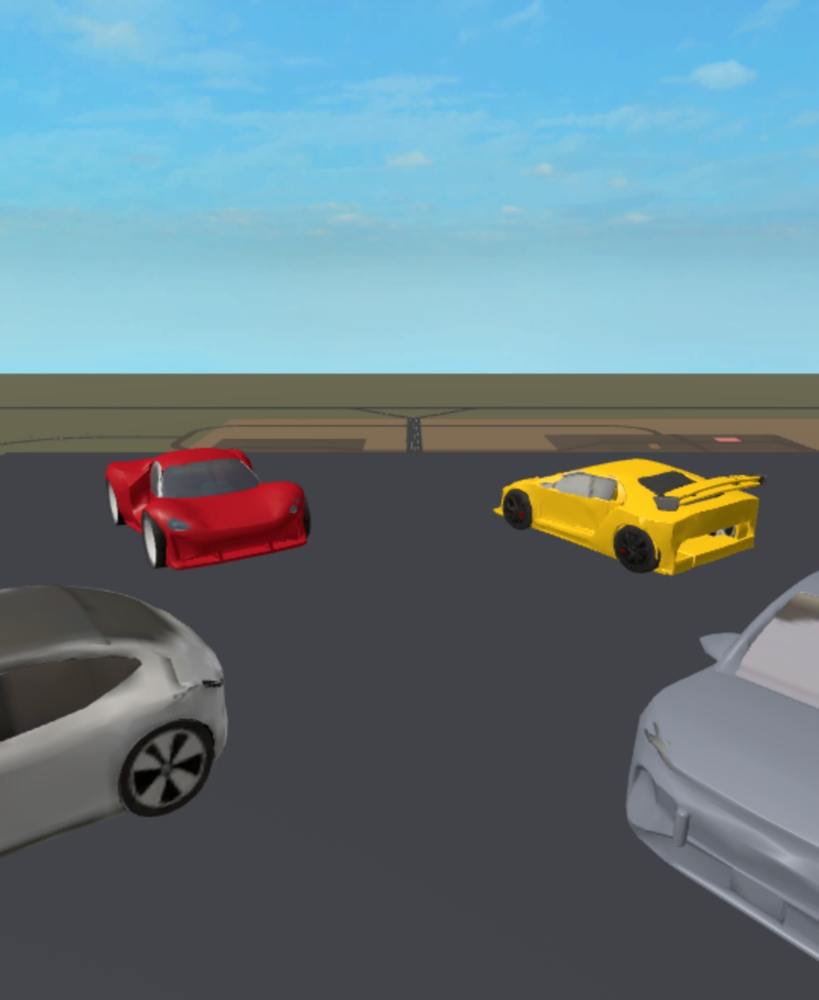
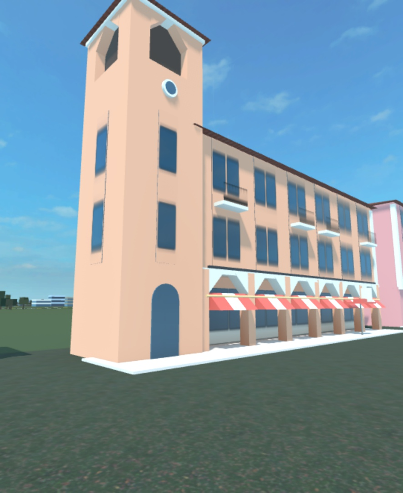

# Voltage County

An original open-world driving and roleplay game for Roblox. A small county with a city, a bay and a drag strip;
over 30 original cars across eight made-up brands; jobs, a robotaxi fleet, houses to own; and an AI Car Designer
that turns a player's description into a new car.

  
  

## What's in it

- **Server-authoritative.** About 45 server services: economy, dealership and used lot, garage, charging and fuel,
  jobs, towing and freight, robotaxis and traffic, houses, a season pass and limited drops. Clients send intents
  ("buy this car"), never outcomes ("add $500"); the server checks and decides.
- **One network module.** Every remote is declared in `src/shared/Net.luau` with a payload validator and a
  per-player rate limit.
- **Data-driven.** Cars, brands, prices and every tunable live in `src/shared/Config/`. Player data is versioned,
  and every schema change ships with a migration.
- **AI Car Designer.** A small TypeScript service on Vercel (`backend/`) asks Claude for a car, validates and clamps
  the answer, and keeps daily spend caps and per-player limits in Supabase. Credits are reserved when a request
  starts and refunded on any failure. The threat model is in `docs/SECURITY.md`.
- **Tests.** An in-repo harness runs about 2,700 specs inside Roblox Studio (`tests/`).
- Built in 15 phases; each one is logged in `docs/PROGRESS.md`.

## Stack

Luau (strict mode), Rojo, Wally, Selene, StyLua, react-lua for the UI. Backend: TypeScript, Zod, the Anthropic SDK,
Supabase, Vercel.

## How it was built

With Claude Code as a pair programmer, one phase at a time. The rules it works to are in `CLAUDE.md`.

## Running it

Setup, Studio sync and test commands are in [docs/DEVELOPMENT.md](docs/DEVELOPMENT.md).
