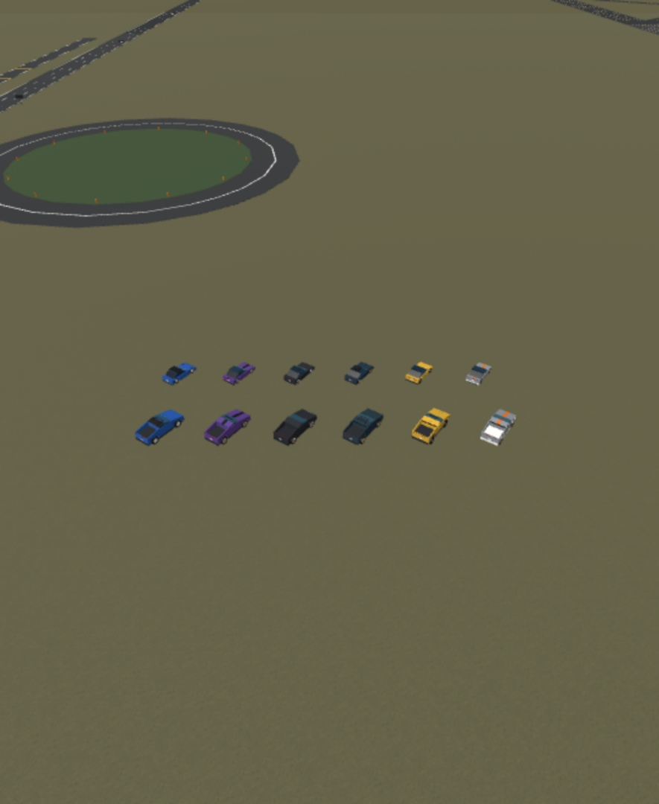
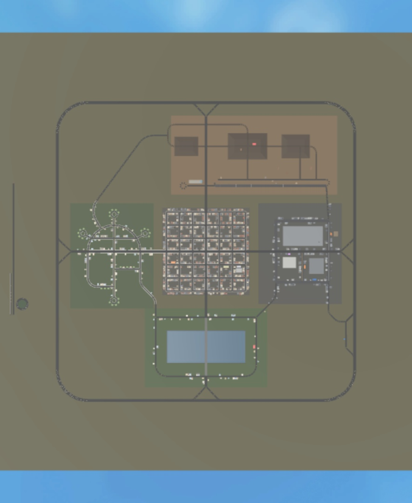

# Progress log

Newest first. Each entry: what shipped, how to try it in Studio, open issues.

## 2026-10-26 — Miami city: hand-modelled buildings, beach, bay, lighting, roast fixes and a showcase

Davis, 2026-10-25: redo the buildings and the scenery, Miami not Greenville, every building hand-modelled from its own
real inspiration, sharp, with better lighting; keep the gameplay. Branch `miami-city`. Nothing is committed or
published yet.

**What was built (the whole rebuild)**
- 52 building types researched from real Miami buildings (`docs/city/ARCHETYPES.md`: inspiration, massing, colours,
  night lights, part budget). 50 are written as Edit-mode builders, one file each in
  `src/server/Dev/City/Archetypes/<district>/`, with one config module each in `src/shared/Config/CityArchetypes/`.
  Real building, architect and neighbourhood names stay in `docs/` only: `scripts/banned-city-names.txt` makes the
  gate refuse them in `src/` and `tests/`.
- The building kit (`Dev/City/Kit`) and the placement planner (`Dev/City/CityBuilder`): 238 sites over downtown (the
  towers and supertall one-offs), the beach (a continuous Art Deco hotel row on the shore road), the suburbs (villas,
  cottages, garden apartments, the four claimable house styles), the arts district (mural warehouses, sculpted
  garages, a gallery, the crane yard) and the quarry. Towers merge neighbouring plots and claim part of their block's
  empty core; no plot, pad, lot or gameplay spot moved.
- Scenery (`Dev/City/Scenery`): mesh palms (royal, coconut, sabal), the beach (sand band, dunes, lifeguard stands,
  umbrellas, boardwalks, showers, nets), the bay as parts, the causeway with its lit arch, street dressing and Town
  Square.
- The lighting look (`Config/Environment`, `Services/DayNightService`): Realistic lighting style, shadows, sky light,
  bloom, a 24-minute day with golden hours and a neon night.

**Roast fixes this step** (a fresh reviewer roasted the integrated city: 10 points; worst first)
1. *Towers on a lawn:* downtown's ground is pale concrete (206,202,194) instead of grey asphalt, and every paved lot
   and core claim a shade under it, so the 299 open downtown lots read as plazas. Town Square keeps its grass.
   Not done: pool-deck and parking-deck cores, podiums pulled to the kerb, two or three towers per block (the part
   budgets are nearly full), and the lawn strip between downtown and the hotel row (open county ground).
2. *One cobalt glass:* the glass tokens are now ARCHETYPES.md's pale set (aqua, silver, sea-green, sky blue,
   charcoal, warm smoke) at reflectance 0.27. Towers 160 studs and taller keep floor lines only above 40 studs, so
   the mullion grid no longer turns into a checkerboard from across the city.
3. *Black, mustard night:* the sky is navy going electric blue at the horizon. Cause: the place had no Sky object, and
   without one the engine's night sky stays black whatever the atmosphere says; DayNightService now makes one
   (the engine's default faces) and thickens the atmosphere at night. Lit windows take one of three tints (warm,
   cream, cool) and about a third of the upper window runs stay dark. Night fill light raised for the suburbs.
4. *Old boxes:* none were left after integration; MapCheck now fails if any old box building appears downtown or on
   the beach.
5. *Cold daylight:* the sun was nearly overhead (the engine draws a midsummer sun, so Miami's real 25.8 put it at
   87 degrees) and every south face, the whole Deco row included, stood in blue shade. Latitude is now 50 (noon sun
   63 degrees up, a little south). Warm fill light, a warm sun tint, and a per-hour colour grade (cream by day, peach
   at golden hour, cool at night). Pale and pastel walls are built in Plaster, not smooth plastic.
6. *Pool water:* the glint texture is gone, the bands are darker green-teal into a deep blue-green bay, the bank is
   wet sand, and the sheen is lowered to 0.07 (at 0.18 the seam between two water sheets showed as a straight line).
   Not done: a wavy shoreline and surf.
7. *Dead street level:* lifeguard stands now stand on 11-stud legs with a longer ramp. Not done: café sets on every
   hotel front, parked cars, storefronts on every podium, hedges and driveways in the suburbs.
8. *Landmarks:* the sail tower's head no longer overhangs half the tower as a white slab: it leans out a little over
   a shorter head, its underside glass. Not done: the tiered curve tower, the triple tower's colonnade, the
   telescope tower and the fin tower.
9. *Box trees:* no two-cube broadleaf trees in the city, the parks or the suburbs (palms, sea grape, flat live oak).
   Not done: the royal palm's crownshaft and frond meshes (they are generated meshes in the place).
10. *Low-rise detail:* not done this round.

**Numbers** (the built map, 2026-10-26)
- Map: 25,865 parts of 30,000 (31,749 instances). Building parts 13,638 of 15,000: downtown 7,569, suburbs 3,051,
  beach 2,099, arts 813, quarry 106. 1,501 trees. Skyline model 102 of 200. Building night lights 1,918 (2,200).
- Phone gate: at most 18,773 parts in view at once, of 20,000 (downtown's west edge).
- 238 sites, 33 core claims, no old box buildings; open plots: downtown 299, arts 114, suburbs 40, beach 19, quarry 3.

**Checked in Studio**
- MapCheck PASS (346 of 346 road nodes reachable, 0 road overlaps, every location in place).
- Full spec harness on fresh copies: passed=2677, failed=0. Gate (`scripts/check.ps1`): CHECK PASSED.
- A playtest for the showcase (HUD hidden, scripted camera, the clock moved with `DevClockTime`): 12 stills in
  `docs/images/city/showcase/` (01 skyline across the bay at golden hour ... 12 the night skyline), including a
  pink supercar in front of the Deco row. Lighting style and quality were as the place has them.
- Not checked: a real phone, and a long drive with the new lighting.

**Waiting on Davis**
- Terrain water for the bay (it changes what happens when a car drives into the water). The bay stays parts until then.
- `Lighting.Technology` = Future in Studio (a script can't set it), then publish so live servers get the lighting
  style and quality the place now has (`docs/LAUNCH.md` step 10).
- The invented sign names (THE AMPERE, SEAVOLT, TIDEWATT...): keep or veto any.
- The open lots (`City.openFallback`): keep them as plazas, or spend the last ~1,200 in-view parts on more buildings.
- A Studio asset in the place loads as the wrong type on boot (`rbxassetid://203785492`, not in the repo).

**Still weak** (from the roast, not done): street life on the hotel row and downtown podiums, the lawn strip between
downtown and the beach, the generic towers still read as glass with white lines at night, the palm crownshaft mesh,
the arts district's murals and the tiled midrise's tilework, and the tiered curve, triple, telescope and fin towers.

## 2026-10-24 — Roast fixes: sound, day and night, price ladder, first session, exclusive looks

A fresh reviewer roasted the game before launch (`docs/roast-2026-10-24.md`, 10 points). Five helpers fixed what code
can fix this round, then a reviewer checked their work (14 findings, all handled by the fixer). The lead then fixed
the car art in Studio (below) and ran the checks.

**Shipped**
- **Car sounds and car signals (point 2):** `Controllers/VehicleSoundController` plays an EV whine that rises with
  speed, fuel engines that rev through the 5-gear automatic and dip at each shift, tyre squeal on a handbrake slide,
  and wind at speed. Horn (H, held), headlights (L), indicators (Z, V) and hazards (X) go through Net `CarSignal`
  (`Services/CarSignalService`: the driver of their own car only); headlights come on by themselves at night. Touch
  phones get a Horn and Lights row above the pedals (`UI/Phone/Layout.touchZones` counts it, so the phone button,
  phone sheet, job slot, hitch row, fleet chip, charging card and goals card all keep clear of it).
  - The 8 sounds were made with ElevenLabs (about 210 credits) and their asset ids are in `Config/Audio`. Roblox's
    audio review passed them: all 8 load in Studio.
- **Day, night and the county art pass (point 3, partly):** a 24-minute day (8 minutes of night,
  `Services/DayNightService`), streetlights, lit windows and lit landmarks (tag `NightLight`; claimed houses'
  windows and porch lights too). `Dev/MapBuilder` adds 1,200 to 1,800 trees, grass patchwork, hills, parks, building
  facades (glass per floor or corner piers, roof edges) and 4 landmarks (water tower, Overlook Diner, bridge arches,
  the Ohm roof sign). The map budget is now 16,000 parts (`Config/Environment.budget`; PLAN.md §5 says why). Not
  done: the stadium, 2,000+ trees, and traffic made from real car bodies.
- **Price ladder (point 5):** only exotics and hypercars are under 3 s to 60 (exotics 2.1-2.6 s, handling 0.87-0.95).
  The free starter is 100 mph, 7.0 s, 22 min; the Ohm Mesa is $86,000; the Fernlow and Fernlow Deluxe on the used
  lot are now quicker and grippier than the starter (6.8 s / 0.46 and 6.4 s / 0.48). New specs: Catalog.spec
  "Catalog price ladder" (every car under $40,000 must beat the starter at 0-60, top speed or work pay) and
  Tuning.spec (no AI-designed car out-launches the Arc).
  - Designs that already exist in the sedan, pickup, sports, muscle and luxury classes get 0.2-0.5 s slower at
    their quickest, because their stats come from the new bands.
  - EconSim, expected (mid player, no VIP; still to be run in Studio): New Ohm Spark 0.55 h, crossover or pickup
    1.98 h (was 2.05), semi 4.77 h, Arc 15.92 h, Arc Boost 43.82 h, all on target.
- **The first five minutes (point 8, partly):** a new player spawns seated in their free Spark on the street by the
  used lot, and the Arc boost-hops over them (`Controllers/ArcFlyoverController`, drawn on their screen only). The
  goals card then walks them through three steps, each one tap, each paid once (`Services/GoalsService`, Net
  `ClaimGoal` / `GoalsUpdate`, schema 8): a first fare that starts by itself and pays a $3,000 bonus (the passenger
  now sits in the car), a test drive of the Arc ($1,000; the GPS leads to the Arc itself, and the car they had out
  comes back when the drive ends), and designing their free car ($1,500). After that come three daily goals. Skipping
  the steps takes two taps, because it gives up the bonuses for good.
- **Exclusive looks and launch day (point 9):** every exclusive look paints the whole body of any car and adds what
  paint can't: mirror chrome, brushed metal or a pearl coat, plus a colour drift, coloured glass or underglow. Season
  One Gold now drifts gold to champagne with gold underglow, and Arc Streak has ice-blue underglow, since chrome alone
  may not show on a phone. The store names each look ("Starter Spark look: Amber pearl that slowly shifts to coral"),
  and looks with underglow join the light shows' underglow cues. Launch day is one number in `Config/Launch`, read by
  the season, the launch-week limiteds and the launch events.

- **Car art (point 1, partly; the lead, in Studio):**
  - The three lookalikes are remade as original bodies, each generated at its car's real size so it isn't stretched:
    Kaze Rinto (now a late-80s style coupe), Aldermoor Belcourt (a 60s two-door with four round lamps) and Brannock
    Calder (a 70s hardtop with stacked square lamps). Earlier tries that looked like other famous cars were thrown out.
  - The Ohm Arc, the hero car, has a new clean body with a wing and spoked wheels instead of the lumpy one. Its
    thruster nozzles no longer stick out of the tail as black pipes: they go with the greybox body now
    (`Dev/ArtPass`), and the plumes still come from the Chassis attachments.
  - Tried and dropped: keeping the generated body texture under a tinted paint (SurfaceAppearance). Side by side the
    flat paint looked clean and the textured one turned into a blob with painted-over windows, so the paint stays as
    it was.
  - Lit windows at night glow a dim warm colour; the first, brighter one turned whole floors into flat yellow slabs.
  - The goals button now sits in the top corner beside the cash, not in the middle of the view.

**Checked in Studio:**
- Tests: `TESTS: passed=2504 failed=0`.
- Map rebuilt: 15,485 parts (trees 4,581, buildings 5,496 after capping downtown at 4 floor bands; the building
  budget is 5,600 and the map's 16,000). MapCheck PASS: 0 overlaps, 0 missing, 0 unreachable, route max 0.13 ms.
- Playtest: 40 services and 33 controllers boot with no errors from the game. At dusk (DevClockTime 19.2) IsNight
  turns on and all 1,113 night lights light. The goals button shows.
- The 8 sounds load (Roblox's review passed).
- The new bodies fit with no problems: Kaze Rinto 21 parts, Aldermoor Belcourt 23, Brannock Calder 23, Ohm Arc 22-23
  (no nozzles). Screenshot: `docs/images/roast-fix-new-bodies-2026-10-24.jpg`.
- Not run here: a full first-session playthrough on a fresh profile, a drive to hear the engines, and the phone
  layout in the device emulator. Davis checks those.

**Open issues**
- Point 1 is partly done (the lookalikes and the Arc; hand-finished hero cars with interiors and doors are not).
  Points 4 (keeping the designed body), 6 (emergency services), 7 (roleplay depth) and 10 (more to chase) are not
  started. Point 3 is missing the stadium, more trees and real traffic.
- Davis: the light-show music (about 2,700 ElevenLabs credits, needs his yes); a Car Radio pass; the launch date;
  check the bigger map and the new buttons on a real phone.

## 2026-10-21 — Phase 14: performance, security, soft launch

**Shipped**
- **Security:** `docs/SECURITY.md` has one row per remote (69) and per backend endpoint: validator, rate limit, who
  may call it and the abuse it stops. A build gate (`scripts/check-security-table`) fails on a remote without a row;
  it replaces the planned `SecurityDoc.spec`, since specs can't read `docs/`.
  - `Util/Check` hardened: strings are non-empty unless a remote allows "" (only `SetPlate.text`), no NUL bytes, no
    -0, and an over-long list is refused as soon as it passes its cap.
  - Admin-only remotes warn once per player, not on every call, so the admin log can't be flooded (AdminService,
    `DesignerService.hide`).
  - Fuzzing: `tests/NetFuzz.spec` checks every validator in Edit mode; `Dev/FuzzTests` sends the same cases through
    the network in a playtest, with `Services/DevFuzzService` (Studio only) recording server errors and the
    caller's economy.
- **Backend review:** no secrets in the repo or its history. Limits and the spend cap verified on the in-memory
  store (`tests/spend.test.ts`). Supabase tables are RLS-on and service-role only; migration 0002 (sequence rights)
  applied and read back. The shared secret can now be changed with no downtime (`ROBLOX_SHARED_SECRET_PREVIOUS`,
  `tests/rotation.test.ts`; the setup tool's **Change game password** and **Finish change**). The request log keeps
  90 days (`tests/retention.test.ts`), and the privacy page is served at `/privacy`. `npm test`: 97 pass;
  typecheck clean.
- **Data safety:** `tests/MigrationFixtures.spec` (one save per version 1-7, every field kept) and
  `tests/DataSafety.spec` (crash-at-every-step credits, drops, receipts). The DataService close handler now runs
  before ProfileStore's, and CreditsService's join clean-up keys reservations by Player.
- **Performance:** budgets in `Config/Perf`.
  - Part budget (decided here): 60 parts for every built car, 120 for a car dressed in the fullest Wrap & Tint look,
    plus 48 for wrap stripes on designs. The reason is in `Config/Perf` (dressing parts are weightless and never
    collide, so they cost a transform each, not physics). This closes Phase 7's "Busy looks push a car past the
    60-part greybox budget" and Phase 11's busy wheel styles. Checked by `tests/PartBudget.spec`.
  - Generated bodies over 20,000 triangles keep the kit look (`GeneratedAdapter`). A body whose triangles can't be
    counted is still taken (`meshes.rejectUncounted` off) until the counter is proven on real generator output.
  - `Dev/PerfTests` drives the County Loop at highway speed with traffic on and judges frame times against the
    desktop and phone budgets, with `Services/DevPerfService` (Studio only) sampling the server.
  - Streaming: min radius 512 (up from 256), target 2048, Opportunistic, integrity Disabled. Only StreamingEnabled
    is scriptable, so the rest are set by hand in Studio (LAUNCH step 10); a build gate keeps `default.project.json`
    the same as `Config/Perf.streaming`.
- **Compliance and launch:** `docs/COMPLIANCE.md`, `docs/LAUNCH.md` (13 steps for Davis) and `docs/privacy.html`.
  - Paid redesigns are gone: a redesign skips the design service's cache and can change the stats, so a paid one
    was a paid draw. Redesigns are only ever free; "Re-roll" reads "Redesign" and "Surprise me" reads "AI picks".
  - The AI notice says the AI isn't a person and can be wrong, and not to type personal info.
  - The "AI picks" fallback class is no longer random.
  - `Dev/ForgetPlayer` handles deletion requests: drag strip times, serial owners, the design service's rows (and
    the save, when asked).
- Built by 5 helpers, then reviewed (13 findings, 3 serious, all handled; see the fixer's report).

**Checked in Studio:**
- Tests: `TESTS: passed=2360 failed=0` (NetFuzz, MigrationFixtures, DataSafety, PartBudget, GeneratedAdapter and
  ForgetPlayer included).
- Part budget, measured: most parts as built 54 (budget 60); fullest dressed look 88 (cap 120: a design with turbine
  wheels); with a wrap 116 (cap 168: a pickup design with the tricolor wrap). The two new art supercars are 21 as built.
- **Fuzz test in a playtest** (48 checks, all passed): all 43 player-facing remotes got hostile payloads, extra
  arguments and a burst over their rate limit. Every call was refused, with 0 answered and 0 errors. The server
  logged 0 errors or warnings, the economy was unchanged (cash, credits, cars, designs and the rest), and the
  client logged 0 errors.
- **Perf drive on desktop** (all checks passed): 135 s on the County Loop in a Montevale Valtero, average 67.8 mph
  (max 70.6), 0 stuck events, traffic on (12 pods with routes).
  - Client: mean 16.67 ms (60 fps), p95 18.27 ms, worst 32.58 ms.
  - Server: mean 16.67 ms, p95 18.16 ms, worst 21.71 ms.
  - 7,493 parts and 10,904 instances on the server, about 5,100 to 5,550 parts streamed in on the client, and a
    traffic step p95 of 0.043 ms. (Memory reads about 5.5 GB because it is Studio's own total, editor included.)
  - The phone pass needs Studio's device emulator, which scripts can't switch on; Davis checks on a real phone
    (acceptance line 2).
- **Designer credits test** (16 checks, all passed): the free car is used once; 2 credits per new car; the one free
  redesign is free; a redesign past it is refused and costs nothing; a refused design costs nothing; the balance
  never goes below zero.
- ForgetPlayer on a test id (report only, Studio stores): no records found, nothing changed, the delete SQL
  printed.
- Sounds: 0 Sound instances with an id anywhere in the place.
- Chat: TextChatService's channels exist in a playtest, but the place's ChatVersion still reads LegacyChatService,
  and scripts can't change it. Davis switches it in Studio (LAUNCH step 10).
- Backend: migration 0002 applied (anon and authenticated have no use of the `vc_` sequences, service_role does);
  `npm test` 97 pass; deployed to production (rotation, the 90-day cleanup and `/privacy` are live).

**Open issues**
- Davis (LAUNCH steps, plus three questions): the streaming and chat settings in Studio (step 10); change the game
  password before the beta (step 11); check on a real phone; keep or drop the free redesign that comes with a paid
  design (COMPLIANCE section 2); a contact address for the privacy page; under-16 access (step 13) and the starting
  prices (step 8).
- `meshes.rejectUncounted` goes back on only after a playtest with the real backend shows no "takes its generated
  look uncounted" line.
- The shared Supabase project has security warnings that belong to other apps (not the designer's tables).

## 2026-10-21 — Phase 13: houses and social roleplay

**Shipped**
- **Houses:** 26 claimable plots in Riverside, one per player per server, claimed at the plot's sign. The house is
  built with your display name on the sign, a garage door that opens for your car, and a home charger. The claim
  goes when you leave the server and the plot frees up.
- **Home charger:** 200 kW, between the public stalls, and it charges only the owner's car.
- **Upgrades:** faster charger (300 kW) $15,000, solar roof $20,000, garden $5,000, porch lights $3,000,
  mailbox $1,500. They are bought with in-game cash and follow you to the next house you claim.
- **Phone:** a Home app (status, address, upgrades, "Set GPS home") and a Feed app (recent server events, newest
  first).
- **Car meets:** when 4 or more players' cars park at one meet spot, everyone gets a feed post and a toast once.
  There's no new announcement there until it drops below 4 and 10 minutes pass. Counting runs on park and unpark
  events, not a loop.
- **Nametags:** display name plus the title of your best job level (e.g. "Freight Hauler II"). They hide while
  driving fast.
- **Also:** Roblox's own bubble chat (nothing custom), and an Emotes app (default emotes, on foot only).
- **Review:** built by 3 helpers, then reviewed: 6 findings, all fixed. The serious one: meets didn't count cars whose
  owner sat still in them.

**Checked in Studio:**
- Tests: `TESTS: passed=2156 failed=0` (with the art pass and the new supercars).
- **House test in a playtest** (30 checks, all passed):
  - Claimed 1 Cedar Court; all 16 house pieces built; your name on the sign.
  - A stand-in car that isn't yours sat on your charger at 50 % for 6 s and didn't charge.
  - Your own car charged at 0.875 %/s, the server's rate for 200 kW, which sits inside the public stalls' range
    (0.82–1.08 %/s).
  - Moving out took the house down and stopped charging, and the plot could be claimed again.
- **Meet test** (15 checks, all passed): nothing was announced with 3 cars parked over 8 s; the 4th car brought
  "Car meet at Lakeview Overlook! 4 cars parked up." within 0.05 s; a 5th car didn't announce it again.

**Open issues**
- Backlog for after launch (PLAN): emergency and roadside roles, trading classics.

## 2026-10-21 — Art pass: realistic, high-detail cars (+ two new Montevale supercars)

**Shipped**
- **Every car is realistic:** all 32 catalog cars (80 trims) and the 3 trailers now have high-detail bodies made with
  Studio's mesh generator. Each car has 8 parts (body, glass, head and tail lights, 4 wheels), and each piece is
  under 20,000 triangles. All are original designs: drafts that looked like a real car were thrown out and
  made again.
- **Driving is unchanged:** `Dev/ArtPass` fits each body onto the car's existing frame, wheels and seats. Paint,
  window tint, wheels, lights (left and right kept apart for light shows), brake and reverse lamps, roof racks,
  spoilers, plates and the hood camera all work on the new bodies. Trailers keep clear of a coupled truck.
- **Wraps on the new cars:** stripes can't sit on curved bodies. So each paid or earned wrap goes on as a full-body
  colour there, and keeps its stripes on designed cars.
- **Two new Montevale supercars** (Davis: "add some lamborgini cars"; original designs, no real brand):
  - **Vorrena:** long, very low, bubble canopy. $780k / Ultima $1.05M, 208–214 mph.
  - **Ardenza:** cab-forward track car with a swan-neck wing. $520k / Corsa $640k, 196–202 mph.
  - The generator's first tries looked like real Italian and British supercars, so they were made again with
    their own design cues.
  - Vorrena 0–60 is 2.5 s / Ultima 2.3 s (not 2.4 / 2.1). As a fuel car at 2.1 s it out-launched the Arc, and a
    spec keeps the Arc the quickest car in the game.
  - A spare winged Vorrena design is kept in `ServerStorage.ArtPassIncoming` in case Davis prefers it.

**Checked in Studio:** every art model passes the contract and art checks (the new supercars at 21 parts each);
screenshots in `docs/images/art-pass-*`.

**Open issues**
- Whether the full-body colour is the right look for the exclusive wraps on the realistic cars is Davis's call
  (TODO, "Waiting on Davis").

## 2026-10-21 — Phase 12: store, passes, Voltage Club, drops, season pass, events

**Shipped**
- **Store** (phone Store app, three pages):
  - credit packs (5, 15 + 3 bonus, 40 + 12 bonus), cash packs, an extra custom-car slot, the Starter Pack
  - passes: VIP, Fleet Manager, Garage+, Light Show Pro, Custom Plates, Season Pass
  - the Voltage Club subscription card, private servers with the Roblox Plus prompt, daily reward, invite
- **Prices come only from Roblox.** Nothing has a real id yet, so every item shows "Coming soon" with no buy button
  until Davis creates it in the Creator Dashboard and pastes the id. A spec fails the build on any hard-coded
  Robux price.
- **Payments:** every purchase is recorded with its purchase id in the same save as the grant, and only confirmed to
  Roblox once that save is in the DataStore, so a repeat delivery grants nothing. Credit packs go to the designer's
  credits; the "Out of credits" sheet opens the store.
- **Passes work:** VIP +20 % job pay and a chat tag; Fleet Manager +5 pod slots and auto-collect; Garage+ +10 garage and
  +2 custom slots; Custom Plates; Light Show Pro.
- **Voltage Club:** credits once per paid billing month, perks off when it lapses.
- **Starter Pack:** offered after the first design and after the first job payout, never again once bought.
- **Limited drops:** serial-numbered by an atomic DataStore update (Arc Flight ships only this way; the first drop is
  scheduled in the future); a failed grant is retried on the next join. Six exclusive wraps exist for the Starter
  Pack, the club and the first season.
- **Season Pass v1** (30 tiers, free and premium), **daily streak**, **live events** (UTC schedule, featured car,
  earnings multipliers, bonus-credit weekends, countdown banner; switch on without a restart), **live feature
  flags** (a kill switch per feature, the designer included, read every 60 s).
- **Billboards:** 10 ad-ready billboards along the County Loop and at the charging plaza, showing in-game brand posters
  until ads are on. Rewarded video ("watch an ad for a credit a day") is built but switched off until the game is
  eligible.
- **Admin panel** (Davis's account only): kick, despawn a car, recent logs, hide a design. Analytics funnels for
  onboarding, the designer and revenue. `docs/DROP_TEMPLATE.md`.
- Data v7 (`cosmetics`), with a migration and specs.
- Built by 4 helpers, then 2 reviewers: 12 findings (5 serious), all fixed. The serious ones:
  - a purchase was confirmed before its save was safe
  - club credits could pay for an unpaid cycle
  - the Starter Pack never showed in the store
  - items promised looks that didn't exist

**Checked in Studio:**
- Map rebuilt with the billboards (6,836 instances), MapCheck clean.
- Tests: `TESTS: passed=1804 failed=0` (incl. receipt 3× → granted once, club once per month, Starter Pack once,
  200 attempts on a supply of 50 → serials 1–50, an event switching on under a fake clock, no Robux prices).
- **Store test in a playtest:**
  - 32 items with no id all showed "Coming soon"
  - each of the 9 products, bought with a test purchase, granted exactly its amount, and the same purchase sent
    again granted nothing (credit bonuses included: 15 → 18, 40 → 52)
  - the daily reward and season tier 1 could each be claimed once

**For Davis (when you're ready to sell):** create the passes, products and the Voltage Club in the Creator
Dashboard and send me the ids (or paste them in `Config/Monetization`); turn on Managed Pricing there.

**Open issues**
- Not built yet: the VIP and club lounges (map work), Boombox, plate frames (the limited frame stays "Coming soon").
- Whether limited cars can be sold back is Davis's call.

## 2026-10-20 — Phase 11: the AI Car Designer and AI mods (end of Milestone C)

**Shipped**
- **Design kit v1** (`Config/DesignKit.json`, shared with the backend): 11 designable classes, 11 body templates, part
  variants (bumpers, spoilers, lights, the 8 Phase 7 wheel styles), 8 extras, finishes, stripes and 4 personalities.
  Stats come only from the class band and personality (capped at 85 % of the band), so text can never make a
  faster car.
- **Builders that run in the live game:** the greybox body code moved out of the Studio-only builder into
  `Vehicle/BodyKit`. A spec fingerprints every catalog car against the stored models, and none changed.
  - `SpecBuilder` turns a design into a drivable car.
  - `ModBuilder` applies an AI mod: catalog cars only take paint, stripes, wheels, stance and extras.
  - Designs join the catalog as `custom:<id>`, so tuning, energy, jobs, the garage and Wrap & Tint all work for
    them unchanged.
- **AI look:** when Roblox's generator finishes in time, a new design shows a generated body for that session.
  The saved car always rebuilds from its kit spec (Davis's choice).
- **Credits:**
  - the first new car is free, exactly once; then a new car costs 2 credits with one free re-roll, and a mod 1
  - credits are held when a request starts, spent only on success, and refunded on a refusal, an error, a timeout
    or a mod that changes nothing
  - the balance never goes below zero
- **Safety:**
  - the player's words are filtered by Roblox before anything leaves the game, and only the filtered text, the
    class, a salted player hash (salt kept in a DataStore, never in the repo) and the kit version are sent
  - every AI answer is checked again in the game: kit values only, clamped numbers, re-filtered name and tagline,
    and a real-brand-name scan
  - report and admin-hide for designs; the AI disclosure shows before the first request
- **Backend** live at `voltage-county-designer.vercel.app`:
  - shared-key check, per-player and global limits, a daily spend cap and an on/off switch
  - a cache of earlier answers and a prompt blocklist
  - structured answers from Claude, with the system prompt cached
  - its tables live in the existing Supabase project under a `vc_` prefix (Davis's call: no new paid project)
  - it answers "not set up yet" until its keys are in, and the game then refunds
  - 76 backend tests pass
- **Screens:** the Design Studio at The Plant and the phone's Designer app (prompt with a counter, class or
  "surprise me", costs, progress, result card with Build / Re-roll / Discard), "Mod with AI" in the garage, an
  out-of-credits sheet (store in Phase 12) and a Report button.
- Built by 5 helpers, then reviewed twice (8 + 7 findings, all fixed). The serious ones:
  - a mod's empty extras list wiped earlier extras
  - mods could charge for extras the car can't carry, or for an accessory that is never built
  - Wrap & Tint wouldn't open on designed cars
  - a seat race when the garage swaps your car
  - the paid-price-0 edge case could use up the free car

**Checked in Studio:**
- Tests: `TESTS: passed=1587 failed=0`.
- **Credits test** with the Studio stand-in backend: every rule above held (free car once, 2 credits, the free re-roll,
  refund on refusal, never below zero).
- **One design per class, all 11, driven** (`DesignerTests.all`, 181/181 checks): each was designed, saved,
  brought out of the garage and seated, settled at its ride height, crossed the bumps at 40 mph (worst tilt
  2.5°), and hit 0–60 within 0.5 % of its own figure, inside its class band. 10 of 11 wore their AI-generated look.
  The mod test passed: catalog cars only change paint, stance, wheels and extras; a refused mod costs nothing.
- **Car swaps while seated:** the garage, a dev spawn or an AI mod swapping the car under a seated player sometimes
  left them standing beside the new car (the old seat's late "stand up" knocked them out). The server now checks
  they stayed seated and seats them again: 8 of 8 swaps held.
- The at-rest "bounce" an earlier run flagged was the test reading instantaneous speed. Every car, catalog ones
  included, jitters about 0.01 studs at 30 Hz at rest, so the check now measures movement.

**For Davis:**
- Turn the designer on: double-click `tools\open_designer_setup.bat`, paste the database key it asks for, click
  **Save and go live**. Then copy the game password into the experience's Secrets as `designer_key` (the window
  says where). After that I run the 90-prompt live test (about 5 cents, approved).

**Open issues**
- Three acceptance items wait for the keys: the 90-prompt live suite, limits holding across two servers on the
  real database, and the time-to-drivable numbers through the real backend (10 s kit, 60 s generated).
- The optional generated accessory on mods isn't built (the AI is told to use kit extras instead).
- With busy wheel styles the 60-part greybox budget leaves no room for stripes; the realistic-car art pass will
  change that budget anyway.

## 2026-10-20 — Phase 10: hypercar thrusters and the drag strip

**Shipped**
- **Arc tuning:** every Arc trim now has the quickest 0–60 and the most grip in the game (Arc 1.8 s, Boost 1.4 s,
  Flight 1.2 s; handling 0.96 / 0.98 / 1.0), above anything another class band allows (spec).
- **Boost-hop** (Arc Boost and Arc Flight): `Q`, a gamepad button or the touch **Boost** button. About 2 s of
  forward and upward push, 20 s recharge, only above 20 mph, never in a no-fly zone. White cold-gas plumes from
  the thrusters, seen by every player, plus a hiss (silent until a sound is uploaded).
- **Flight** (Arc Flight, limited drops only): over the Flight Field, hover up to 25 studs for 4 s; steer to roll,
  throttle and brake to pitch and flip; then a controlled landing. 45 s recharge.
- **AbilityService** (server-authoritative): checks driver, owner, trim, recharge, another ability running, zone
  (by the car's server position) and speed (the server's own view). It opens a per-car speed allowance only for the
  window and checks the car stayed within bounds. After landing it checks the car is upright and not inside the
  map, and resets it to the road if not.
- **Drag strip** at the Mesa Test Site: stop behind gate 1 to arm, then the server times the run. It interpolates
  each gate crossing between frames, gives splits at gates 2 and 3, and faults on leaving the strip, a reset or
  thrusters. **Weekly leaderboard** (a separate board per ISO week; Studio uses its own dev board) on an
  in-world sign at the strip.
- HUD chip with the recharge ring.
- Built by 4 helpers, then 2 reviewers. They found 6 issues (2 serious), all fixed:
  - the weekly board accepted impossibly fast times; each trim now has a physics floor and anything under 90 %
    of it is refused
  - the hop got weaker the higher a player's ping; it is now timed from the client's first push
  - cooldowns reset on rejoin; they now follow the player
  - an out-of-bounds car is put back at its last legal spot

**Checked in Studio:**
- Tests: `TESTS: passed=1191 failed=0`.
- **Forged requests:** every one refused with the car unchanged:
  - a hop standing still and at 10 mph
  - a second hop mid-hop and while recharging
  - flight in an Arc Boost; boost or flight in a plain Arc and an Ohm Spark
  - flight outside the Flight Field
  - boost and flight inside the No-Fly Zone
- **50 boost-hops**, all upright on four wheels, none stuck, no resets (about 10.5 studs high).
- **50 flights** with scripted rolls (up to 136° in the air) and throttle input, all landing level on four wheels,
  none stuck (hover about 25.8 studs).
- **Drag strip, two runs:** an Arc ran 8.353 s and 8.318 s. The server's time matched the client's own
  measurement within 0.001 s and 0.035 s, and the splits within 0.022 s (limit ±0.05 s).
- After the review fixes, a shorter rerun (the forged requests, 5 hops, 5 flights, the drag run) passed all
  46 checks.

**Open issues**
- Thruster sound is silent until a sound asset is uploaded (same as the light-show music).
- The leaderboard sign and the HUD chip haven't been looked at on screen.

## 2026-10-20 — Phase 9: robotaxi fleet, ambient traffic, hail a pod

**Shipped**
- **Fleet** (phone Fleet app, a "Buy pods" card on the dealership's Ohm section, a "$X ready" HUD chip):
  - buy Ohm Pods ($40,000 each, 3 slots; +5 with the Fleet Manager pass in Phase 12) and assign each to a zone
  - zones differ in demand: Cedar Bend 1.3×, Lakefront 1.1×, Riverside 1×, The Plant 0.9×, Mesa 0.7×
  - pods earn about $60/min each at average demand (§4), simulated, not driven: rides per hour × fare × demand,
    with a seeded ±10 % per pod per hour, so the same on every server
  - while you're away they earn a quarter as much for up to 8 hours, paid when you come back
  - collect in the Fleet app; sell a pod for 60 % back
- **Data v6:** `fleet.uncollected` and `fleet.lastOnlineAt`, with a migration and specs.
- **Ambient traffic:** 12 pods drive the county's roads in the right-hand lane, slowing for bends. The server only
  publishes routes (a compact buffer); every client draws the same pods from them, with no physics replication.
  Pods slow down behind a player's car on that client only and never collide.
- **Hail a pod:** a Hail button next to each GPS destination in the phone. On foot only; the fare is $30 + $0.04 a
  stud of road, charged by the server. A short ride scene plays (HUD, phone, GPS chip and light-show button
  hidden), then you're at the destination. Refunded if you die, leave or get in a car mid-ride.
- Built by 4 helpers, then 2 reviewers. They found 6 issues (3 serious), all fixed:
  - the long-distance arrival now asks Roblox to stream the destination in first
  - a garage test that didn't know the new fleet field
  - the GPS chip and light-show button hide during a ride
- Then I made traffic cheaper to draw. The pods drop small details and lights (19 parts instead of 34), and pods
  over 300 studs from the camera move every other frame.

**Checked in Studio:**
- Tests: `TESTS: passed=1085 failed=0`.
- **Fleet test** (buy, offline, cap, sell), all checks pass:
  - bought a pod into Cedar Bend for $40,000, 1 of 3 slots
  - 2 h away paid $2,350, against $2,340 expected (a quarter of the online rate)
  - 20 h away paid $9,266, against $9,360 for the 8 h cap; uncapped would have been $23,400
  - sold for $24,000 (60 %)
- **Traffic, 12 pods for 10 minutes, all drawn at once:** 0 stuck, 91 routes driven. Frame cost **0.39 ms mean**
  (budget 0.5), **0.51 ms p95** (budget 1.5). Before the trim it was 0.97 ms mean. Yielding behind a player's car
  wasn't exercised (no car near a pod during the run).
- **Hail a pod** from spawn to the Flight Field (2,749 studs): $221 charged, a 7-second ride with the HUD hidden,
  then on foot 36 studs from the destination with the HUD back. A second ride where the rider died mid-ride
  refunded the $171 fare.

**Open issues**
- The Fleet app, HUD chip and dealership card haven't been looked at on screen (phone resolution still
  unchecked, as since Phase 4).
- The Fleet Manager pass is a placeholder until Phase 12.

## 2026-10-20 — Phase 8: pickup towing and semi freight

**Shipped**
- **Trailers:** three original greybox trailers (box, flatbed, tanker) built by `Dev/TrailerBuilder` into
  `ServerStorage.TrailerModels`. Each has a `Kingpin`, four wheels and landing legs. `Vehicle/Trailer` runs their
  raycast suspension, grip, braking and anti-jackknife yaw damping on the driver's client, like the car chassis.
  Every catalog car now has a `TowPoint` (all 80 models rebuilt).
- **HitchService** (server-authoritative):
  - couples a semi to a trailer at the kingpin, or a pickup / tow truck to a broken-down car, with a
    ball-socket joint; distance, angle, stillness and class are all checked
  - uncoupling works only inside a freight depot, a trailer bay or the County Tow Yard; anywhere else it says why
    and nothing changes
  - `T` on keyboard, RB on gamepad, and Couple / Uncouple buttons on touch
- **Towing jobs** (pickups and service trucks with a hitch): a broken-down car waits on a road shoulder; hook it
  up and tow it to the County Tow Yard.
- **Freight jobs** (semi plus the freight license): short runs between 5 depots, or long hauls round the County
  Loop. The license costs $25,000 and needs level 3 in delivery or towing.
- **Map:** 5 job depots, 9 trailer bays, 2 tow drops and 12 breakdown spots across every zone (MapCheck clean).
- **Phone and HUD:** towing and freight offers, license status with a Buy button, a hitch indicator while coupled.
- Built by 5 helpers, then 2 reviewers. Then I fixed three things from the Studio runs:
  - a test helper that couldn't remove a field
  - the drive to a load was paid by a road route that loops round the block when the truck is already parked
    by it. It is now capped at 1.6× the straight-line distance (`Config/Jobs.approachDetourFactor`).
  - the tow to the yard was measured ignoring which way the truck faces, so a yard behind the truck paid for
    1,085 studs while the drive was 2,890. It is now measured the way the truck leaves the shoulder.

**Checked in Studio:**
- Tests: `TESTS: passed=989 failed=0`.
- **Semi + box trailer, once round the whole County Loop** (25,931 studs) with the AutoDriver: 257 s, 63 mph
  average, 67 mph top. **No jackknife:** the trailer swung at most 2.5° on the highway and 67° turning onto it
  at 25 mph (limit 75°). The hitch never separated, and nothing was reset.
- **Uncoupling on an open road** (380 studs from a depot): refused with "You can only uncouple at a freight
  depot or the County Tow Yard."; still hitched. Uncoupling inside the depot then worked.
- **One freight job end to end:** West Loop Freight Yard to Loop Stop Freight, 11,614 studs, paid $14,621.
- **One tow end to end:** a broken-down car on South Works Road to the County Tow Yard, paid $4,010.
- **Pay rates** (6–8 minutes of back-to-back jobs each, level 1):
  - towing **$1,633/min** vs the §4 target of $1,600 (×1.02)
  - freight **$3,195/min** vs the §4 target of $3,000 (×1.065), over a short run and two hauls of 12,500 studs

**Open issues**
- Turning onto the loop at 25 mph swung the trailer to 67°, close to the 75° jackknife line. Fine at
  highway speed; a sharper player turn could cross it. Phase 14 can look at more yaw damping at low speed.
- Phone screens at phone resolution are still unchecked (carried over from Phase 4).

## 2026-10-20 — Phase 7: customization and light shows

**Shipped**
- **Wrap & Tint shop** at two new `CustomShop` locations (Cedar Bend, The Plant):
  - 22 paints plus a limited custom color; gloss, matte or metallic finish
  - 8 original wrap designs built from parts (no uploaded images)
  - 8 wheel styles, ride height, 5 window tints, 8 caliper colors
  - 8 kit extras on the mount points (spoilers, wing, roof rack, roof box, light bar, bull bar, splitter,
    diffuser), limited by class
  - 4 free plate formats
  - prices scale by class tier and only charge for what changed
  - live preview on your own car, reverted on cancel
- **Vehicle/Appearance** applies a look to any catalog model, idempotently. It never touches physics; ride
  height moves only the visual body.
- **Data v5:** caliper, extras and plate format per owned car. Custom colors are stored in `paint` as
  `custom:h,s,v`.
- **Plates:** custom text is filtered with TextService (PublicChat context) when set and again on every
  spawn. Only filtered text ever appears on a plate, and a failed filter shows a blank plate. Custom text
  needs the Custom Plates pass (Phase 12); until then Studio only.
- **Light shows** at meet spots: 3 placeholder tracks (no audio yet, `assetId = 0`) and beat-aligned routines
  (lamps, doors, gull-wings, light-bar underglow). Players parked at a spot join; every client schedules the
  cues from the server's start time.
- Built by 4 helpers, then 2 reviewers. They found 18 issues (9 serious, 9 minor), and all were fixed. Afterwards
  I fixed the light-show test, which spawned its car before the server had seen the character move.

**Checked in Studio:**
- Map rebuilt with the shops: MapCheck clean.
- Tests: `TESTS: passed=887 failed=0`.
- **Six looks each on the Spark and the Mesa** render (picture above; close-up in
  `docs/images/looks-closeup-2026-10-20.jpg`): different paints, finishes, stripes, wheels, ride heights,
  tints, calipers, a roof rack, a roof box and a light bar. Separately, a scripted sweep applied 72 looks to
  every trim of every catalog car with no errors.
- **Three cars in one light show:** cues fired within **0.5 ms** of each other on this client (allowed 100 ms).

**For Davis to check:** plate filtering only behaves for real in a live (published) server. Set a custom plate
in a private server and confirm it shows filtered to another player. Custom plates are Studio-only until the
pass exists.

**Open issues**
- Light-show music is placeholder silence. Davis approved Roblox's licensed library or original tracks from his
  ElevenLabs account; uploading audio needs the Roblox key's Assets permission (granted) and Roblox's audio
  quota.
- Busy looks push a car past the 60-part greybox budget (wheel spokes, wrap parts). Phase 14 performance may
  trim them.
- The phone can open over the Wrap & Tint panel; the shop closes the phone when it opens.

## 2026-10-20 — Phase 6: jobs, rideshare, delivery (end of Milestone B)

**Shipped**
- **JobService** (server-authoritative):
  - one job per player; offers for the car you're in, filtered by class
  - accept, then stops, with arrival judged from the server's smoothed view of the car (near the stop and
    nearly still)
  - fails on time-out, leaving the car, switching car or the car disappearing; cancel has a cooldown
  - pay through EconomyService with boosts, a job-level multiplier and a VIP hook (1× until Phase 12)
  - XP per job type saved in the profile; level-ups announced
  - drive-to-earn pauses during a job
- **Rideshare:** NPC fares at the hotspots nearest your car, drop-offs 1,800+ studs away by road. Pay is
  base + distance, plus a smooth-driving tip; hard brakes and crashes cut it. XL fares (SUV, minivan, 6+
  seats) pay 1.25×.
- **Delivery:** load at the Parcel Depot, then 3–6 Riverside drops (more for vans, SUVs and pickups), ordered
  nearest-next. Vans, SUVs and pickups also get a 20% bonus.
- **Levels:** 5 per job type, up to +25% pay, unlocking longer fares and routes.
- **Client:** a real Jobs app in the phone (levels, offers for your car, the active job with cancel), the HUD
  job slot (next stop, distance, time left), the GPS following each stop, and simple original figures for
  passengers plus parcel markers at drops.
- Pay is calibrated from §4 in `Config/Jobs`, which explains the math.
- Built by 4 helpers, then 2 reviewers. They found 10 issues (5 serious, 5 minor), and all were fixed.
  Afterwards I relaxed one Phase 5 energy test the new acceleration threshold had made too strict.

**Checked in Studio:**
- Tests: `TESTS: passed=743 failed=0`. The server booted 13 services.
- **Rideshare end to end** (Ohm Spark): Town Square pickup → County Tow Yard: **$2,052 in 117 s
  ($1,054/min)**, +67 XP, $0 from drive-to-earn during the job.
- **Delivery end to end** (Northline Satchel van): depot load and 4 Riverside drops: **$4,363 in 230 s
  ($1,137/min**; target with the van bonus $1,200), +112 XP.
- **Forged "I'm here":** refused 930 studs from the pickup and 2,274 studs from the drop-off ("You're not at
  the stop yet."), logged by the server, nothing paid, the job didn't advance. Claiming another player's job
  is refused too.
- **Rate over chained rideshare jobs:** 4 jobs in 7.7 minutes average **$1,065/min** (target $1,000, ±15%).

**Open issues**
- The §4 rates hold at job level 1; levels add up to +25%. EconSim doesn't count job levels yet.
- Job pay logs to analytics under "Gameplay": `job:*` isn't in `Config/Economy.analytics.transactionTypes`.
- A good time for a friends-only playtest (Milestone B). It needs Davis to invite friends to the private
  experience.

## 2026-10-20 — Phase 5: energy (charging and fuel)

**Shipped**
- **Energy model** (`Vehicle/Energy`, `Config/Energy`). Drain is calibrated so a steady 45 mph on the flat
  lasts exactly the catalog's `energyMinutes`. Speed, launches and climbing cost more; battery cars get 60% of
  braking and downhill energy back.
  - Charging time depends on the stall's power: 350 kW = 60 s, 250 kW = 75 s, 150 kW = 90 s for 10→80%,
    tapering above 80%. The truck charger is faster and serves heavy trucks only.
  - Pumps fill 10→100% in about 22 s.
  - Costs are a small sink: $300 for a full charge, $400 for a full tank, $500 at the truck charger.
- **EnergyService** (server-authoritative):
  - samples every car and drains from server-observed motion
  - charges or fuels at the right kind of station (friendly notice at the wrong kind), billing each %
  - hangout bonus while 3+ players charge at one plaza
  - alerts at 20% and 10%; at 0 the car limps at 15 mph and the GPS points to the nearest compatible
    station
  - AntiExploit holds a limping car to the limp speed
- **Data v4:** each owned car keeps its energy level, so it survives putting the car away and rejoining.
- **Client:** HUD energy bar with a battery or fuel icon, % and range in the player's units (amber under 20%,
  red under 10%), a charging card showing rate and cost, and limp mode in the car.
- **Fix found in Studio:** the server read sample-to-sample wobble in a client-driven car as constant
  launches, so a steady 45 mph cruise drained **2.8× too fast** (12.6 minutes instead of 35). Speed and climb
  are now smoothed over 2 s before billing, and small accelerations (< 4 studs/s²) and climbs (< 0.75
  studs/s) count as steady.
- Built by 3 helpers, then 2 reviewers. They found 13 issues (1 crash, 7 serious, 5 minor), and all were
  fixed.

**Checked in Studio:**
- Tests: `TESTS: passed=612 failed=0`. The server booted 12 services.
- **Cruise:** Ohm Spark at 45 mph on the County Loop: a full charge lasts **33.6 min** (catalog 35, ±10%
  allowed).
- **Charging:** 10→80% in **74.6 s** at the Cedar Bend plaza (allowed 60–90 s), **$211** deducted.
- **Refueling:** Aldermoor Belcourt, 10→100% in **22.2 s** (allowed 20–30 s), **$360** deducted.
- **Limp to a station:** both drives ran at a top speed of 15 mph, the GPS routed both, and charging or
  fueling started on arrival.
  - Battery (Spark): from the County Loop 3,537 studs out to the Mesa Control charger, a 4,890-stud route
    in 207 s.
  - Fuel (Belcourt): 5,014 studs out to the Loop Stop pump, a 5,301-stud route in 223 s.

**Open issues**
- When a player leaves, EnergyService and DataService both react to `PlayerRemoving`, and Roblox doesn't
  guarantee their order. If DataService ends the session first, up to a minute of energy change isn't saved.
  A pre-release hook in DataService would close this.
- A parked car keeps charging (and billing) after its driver walks away. That's what makes plaza hangouts
  work, but Davis may prefer it to stop.
- The test driver can't reverse out of a charging bay; the energy tests start each run on an open road.

## 2026-10-20 — Phase 4: dealership, used lot, garage, phone UI (+ catalog to 32 cars)

**Shipped**
- **Catalog:** 24 new original cars across Halden, Ironwood, Aldermoor, Kaze, Brannock, Montevale and
  Northline, 32 in total.
  - 80 trims; every class is used and every trim sits inside its class band.
  - Mostly electric: 23 battery, 9 fuel.
  - 8 used-lot classics (Grand, Summit, Fernlow, Aurelin, Rinto, Calder, Parlow, Tessaro).
  - Every vehicle has a `bodyStyle`, and VehicleBuilder makes a greybox body for each of the 15 styles,
    with a front face and default paint per brand. The Ohm silhouettes are unchanged.
- **Data v3:** owned cars gain `favorite` and `paid` (migration 2 → 3). `DataService.onChanged`;
  `ProfileSyncService` sends each player their own profile snapshot.
- **Garage:** spawn at the nearest spawn pad, put away, favorite, sell back at 60%. The free starter can't
  be sold, and a car can't be sold twice.
- **Dealership:** 23 cars on display across brand sections in Cedar Bend. "View" opens the shop: brand,
  trims, stat bars, price, Buy with a confirm, a 2-minute test drive (earns nothing), and upgrades (Arc Boost
  needs an owned Arc).
- **Used lot:** today's 10 cars are picked from the UTC date, so every server shows the same stock. Supply is
  shared globally through DataStore `UpdateAsync`, prices rise as copies sell, and a buy refuses if the price
  rose past what the player confirmed. The free-starter claim is real now: a saved used Spark.
- **Phone:** GPS, Garage, Jobs and Fleet ("arriving soon"), Wallet, Codes and Settings (mph/kph, default
  camera, music volume).
- **HUD:** speed in the player's units, an energy-bar placeholder, cash, an active-job slot.
- **Theme:** one shared look (`UI/Theme`) for every screen.
- **Phones forced to landscape** (`StarterGui.ScreenOrientation = LandscapeSensor`). In portrait the touch
  pedals and steering zones overlapped.
- Built by 5 helpers, then 2 reviewers. They found 14 issues (5 serious, 9 minor), and all were fixed.

**Checked in Studio:**
- Rebuilt 80 car models and the map: 6,693 instances, 60 dealership and used-lot pads, MapCheck clean.
- Tests: `TESTS: passed=537 failed=0` (fresh playtest). The server booted 11 services and the client 10
  controllers, with no errors.
- Showroom: 23 dealership cars and 10 used-lot cars on their pads.
- **Exact-cash buy:** with exactly $35,000 a Spark purchase leaves **$0**, is in the saved garage
  (paid 35,000), and spawned at the spawn pad. Selling it back returned $21,000.
- **Forged buy:** the Arc with $1 too little is **refused** ("You need $1 more for that."), cash untouched,
  and the server logs it. Buying an upgrade without the base car, a limited-only trim and an unknown car are
  all refused too.
- **Used lot on two servers:** today's stock (2026-10-20, 10 spaces) is computed identically twice and matches
  what the server answers.

**Not checked:** how the phone and shop screens look at phone size. Claude's screen capture can't see this
Studio session. Davis checks with Studio's device emulator or a phone.

**Open issues**
- The dealership's GPS entry points at the showroom's north entrance; brand rows sit behind it and across the
  street. A second GPS entry may help.
- Northline's tow truck and utility truck are class `service` (tier 2). Phase 6 job eligibility uses class,
  so check they get towing and service work.
- Tuning: the used lot has 10 spaces, 5 copies each per day, and prices rise up to 1.4× as copies sell.

## 2026-10-20 — Phase 3: data, economy, drive-to-earn

**Shipped**
- **DataService** (ProfileStore, vendored):
  - session locking, autosave, `get` / `update` / `waitFor` / `onLoaded`
  - schema **version 2** (timed `boosts`) with ordered migrations that never drop a field
  - kicks with a plain message if a save can't load or opens on another server
  - Studio uses a separate store (`PlayerData_Studio`), so playtests never touch live player data; an
    in-memory mock takes over when DataStores aren't reachable
- **EconomyService:** `add` / `trySpend` (whole dollars, never below zero, capped), earnings multiplier from
  boosts, every change logged to Roblox economy analytics, cash mirrored to the `Cash` attribute.
- **Codes:** `VOLTAGE` ($5,000) and `DOUBLEUP` (2× earnings for 30 minutes) are launch placeholders; `PREVIEW`
  is already expired on purpose. Each code works once per player, is case-insensitive and rate-limited.
- **Drive-to-earn:** the server samples each driven car once a second, pays every minute for distance
  driven on roads (capped), and pays nothing when the car hasn't really moved in 2 minutes (AFK) or its
  2-minute area is too small (circling in a lot). Each payout shows as a toast.
- **HUD:** cash readout at all times, plus a small Codes button (moves into the phone in Phase 4).
- **Dev tools:** `EarnTests` (drive / park / circle) and `EconSim` (below).
- **Fix during testing:** with streaming on, the Driver seat can reach the client a moment before the rest
  of the car. DriveController now waits (up to 5 s, event-driven) for the Chassis and wheels.
- **Tuning:** the Arc is now $2.0M (plan said $1.5M) and the Arc Boost upgrade $5.0M (plan said $2.5M);
  the hypercar band is $1.5M–$8M. Freight's $3,000/min otherwise gets a mid player to them far faster than
  §4's targets.
- Built by 3 helpers, then 2 reviewers. They found 6 issues (2 serious, 4 minor), and all were fixed.

**Checked in Studio** (published place, connector):
- Tests: `TESTS: passed=326 failed=0`.
- Data loads in 0.7 s. **Cash survives stopping and restarting play** ($7,500 before and after).
- Codes:
  - `VOLTAGE` added $5,000; using it again → "You've already used that code".
  - `PREVIEW` → "Sorry, that code has expired".
  - A fourth try within seconds is refused by the rate limit.
- Drive 2 minutes with the AutoDriver: **$612, $306/min** (§4 target $300). Minute 1 was $294 over 3,762
  studs; minute 2 was $318 over 4,062.
- Parked 3 minutes: **$0** (AFK each minute).
- Circles in a lot for 2 minutes: **$0** (the car only covered a 38-stud area, so the AFK rule caught it).
- Tests after the price change, rerun in a fresh playtest: 326 passed, 0 failed. In Edit mode Studio keeps old
  module copies between runs, so config changes need a playtest to show.

**EconSim** (hours of play to each milestone, before the Arc price change; target in brackets):

| Milestone | Target | Casual | Casual+VIP | Mid | Mid+VIP | Grinder | Grinder+VIP |
|---|---|---|---|---|---|---|---|
| New Ohm Spark | ~0.5 | 0.88 | 0.75 | 0.55 | 0.47 | 0.48 | 0.40 |
| Crossover or pickup | 1–2 | 3.32 | 2.82 | 2.05 | 1.72 | 1.78 | 1.50 |
| Semi | 4–5 | 7.97 | 6.72 | 4.83 | 4.02 | 4.20 | 3.50 |
| Ohm Arc | 15–20 | 22.38 | 18.78 | 13.20 | 11.00 | 11.47 | 9.57 |
| Arc Boost | 40–50 | 46.42 | 38.90 | 27.15 | 22.60 | 23.60 | 19.65 |

Rerun with the new Arc prices ($2.0M, upgrade $5.0M); the first three rows are unchanged:

| Milestone | Target | Casual | Casual+VIP | Mid | Mid+VIP | Grinder | Grinder+VIP |
|---|---|---|---|---|---|---|---|
| Ohm Arc | 15–20 | 27.18 | 22.82 | **15.98** | 13.32 | 13.90 | 11.58 |
| Arc Boost | 40–50 | 75.25 | 63.05 | **43.88** | 36.53 | 38.13 | 31.77 |

The mid player is on target everywhere except the crossover/pickup at 2.05 h (target 1–2 h, slightly over).

**Open issues**
- Launch code names and amounts are placeholders. Davis picks the real ones before launch.
- Desktop chat sits in the top-left corner by default and can overlap the cash readout. Phase 4's HUD
  redesign moves cash.
- Drive-to-earn doesn't add to `stats.milesDriven` yet (no phase owns it). Add it with the Phase 4 garage stats.

## 2026-10-19 — Phase 2: greybox county, road graph, GPS

**Shipped**
- **County layout** (`Config/MapLayout`): six zones, 85 tagged locations covering every PLAN §5 tag with its
  attributes, and 18 GPS destinations.
  - Cedar Bend downtown is a 7×7 grid with the used lot (player spawn), dealership, charging plaza and fuel
    station.
  - Riverside has curving streets, four cul-de-sacs and 26 house plots.
  - The Plant has 4-lane concrete roads, the factory, Design Studio, freight depot and truck chargers.
  - The Mesa Test Site has dirt trails over three hills, a quarter-mile drag strip with gates 1–4, a flight
    field with jump ramps and a no-fly zone.
  - Lakefront has Cedar Lake, a bridge deck 22 studs above the water and the meet-spot overlook.
  - The County Loop is a 4-lane, 70 mph ring with an interchange at each avenue and a service stop.
- **Road graph** (`Config/RoadGraph`): 344 nodes and 415 edges, connected and planar except one bridge.
  Grades stay within limits.
- **Road modules:**
  - `Road/Graph`: grid-indexed nearest edge, on-road check, zone lookup.
  - `Road/Pathfind`: fastest-route A* that joins and leaves roads mid-edge.
- **Map builder** (`Dev/MapBuilder`): rebuilds `Workspace.Map.Generated`, about 6,600 instances:
  - ground, roads, intersections, lane lines, sidewalks, bridges
  - zone-colored buildings grouped per block
  - streetlights, tagged locations with props, player spawns
  - roads and ground are Persistent so fast cars never outrun streaming
- **GPS:** a destinations panel, a route line drawn on the road, re-routing when you go off route, and an
  arrival notice. Plus toast notices, and the used-lot "Claim your free car" prompt. The prompt hands out a
  temporary test-drive Spark until Phase 4's garage.
- **Streaming** is on. The dev test track moved west of the County Loop.
- **Fallback sync:** `tools/studio_sync.py` with `tools/StudioSync.luau` pulls the repo's code into Studio
  through the connector when nobody is there to click Rojo's Connect. It touches only the four code folders.
- Built by 4 helpers, then 2 reviewers. They found 6 issues (3 serious, 3 minor), and all were fixed.
  Afterwards I fixed two specs whose tolerances were too tight for Roblox's 32-bit positions, and one spec
  whose "off route" point was actually near the route.

**Checked in Studio** (published place, connector):
- Tests: `TESTS: passed=241 failed=0`.
- MapCheck: two builds both give 6,590 instances, 0 overlapping road parts, every node and location
  reachable. Routes from the spawn to all 18 GPS destinations take at most 0.09 ms (the limit is 5 ms).
- Route test: **13 of 13 drives completed, 0 stuck events.**
  - One route into each zone and back, at about 30 mph.
  - The full County Loop: 26,074 studs in 300 s at up to 55 mph.
- A player spawns at the used lot in Cedar Bend, and the claim prompt is there.

**Davis did:** published the place (now "Voltage County", private, universe 10772006656) and turned on Studio
access to API services. Claude turned on Allow HTTP Requests, which Phase 11's AI Car Designer needs anyway
and the fallback sync uses.

**Open issues**
- Pressing the claim prompt can't be automated from a test script. Davis tries it: walk up and press E.
- Rojo can only set `StreamingEnabled`; Roblox doesn't let plugins write the streaming radii. They need
  setting once in Studio's Properties panel (Workspace): `StreamingMinRadius` 256, `StreamingTargetRadius`
  2048, `StreamOutBehavior` Opportunistic.
- The drag strip has about 990 studs of run-off after the finish, which may be short for the Arc Boost.
  Revisit in Phase 10.
- House-plot pads sit behind the sidewalk kerb with no driveway gap yet (Phase 13).

## 2026-10-19 — Phase 1: chassis, classes, generation spike

**Shipped**
- **Catalog:** 8 fictional brands, 13 classes with tiers and stat bands, and all 8 Ohm vehicles with every
  trim and body geometry. `Vehicle/Catalog.validate()` checks every trim sits inside its class band.
  - Long Range trims get the most range, since that's what the name sells. Straight interpolation from the
    plan would have given them less than Standard.
  - The Hauler Long Range isn't in the plan, so it was filled in.
- **Physics** (`Vehicle/Tuning`, `Powertrain`, `Chassis`, `WheelVisuals`, `Config/Driving`):
  - raycast suspension on one invisible chassis body, mass-independent and frequency-based, with impulse
    clamping for 30–144 fps
  - electric single-speed or fuel 5-gear automatic, regen low/standard/high, Comfort/Standard/Sport,
    traction control, reverse by holding brake, handbrake slides
  - peak acceleration calibrated per trim so 0–60 matches the catalog
  - other players' cars animate their wheels too
- **Server:** `VehicleService` (spawn, Drive/Ride prompts, ownership to the driver, park on exit, 10-minute
  despawn, one car per player, Studio-only dev spawn) and `AntiExploitService` (speed cap at top × 1.15
  and teleport detection on server-observed positions, reset → log → kick with decay; pure `MotionGuard`).
- **Client:**
  - controls: keyboard, gamepad and touch, through ContextActionService (the docs don't recommend the
    newer system over it)
  - the drive loop, chase/orbit/hood camera with speed-scaled FOV, HUD stub (speed, gear, mode)
  - on-screen touch pedals and steering, and a Studio-only spawn menu
- **Dev tools:** `VehicleBuilder` (18 greybox models, one per trim, 36–52 parts each, to the model contract),
  `DevTrackBuilder` (2,400+ stud straight, skidpad, speed-bump lane), `AutoDriver`, `GenerationSpike`.
- `docs/ART_BRIEF.md` for an artist; `docs/phase-1-contracts.md` is the agreement the modules were built to.
- **Network:** two remotes declared in Net (`DevSpawnVehicle`, `VehicleReset`); remotes now carry a direction,
  and a client firing a server-only remote is rejected.
- Built by 5 helpers in parallel, then 2 reviewers. They found 14 issues (3 serious, 11 minor, none
  crashing), and all 14 were fixed.

**Checked in Studio through the connector** (place file open, Rojo connected, not yet published):
- Tests: `TESTS: passed=153 failed=0`.
- Ohm Spark Standard 0–60: **4.99 s** (target 5.0, pass band ±15%). Ohm Arc 0–60: **1.90 s** (target 1.9).
- Spark settles at 0.65 studs of ride height (0.7 configured), upright, client owns its physics.
- Arc (lowest car) over the speed bumps at 40 mph: worst tilt 2.6°, upright, no stuck events.
- Forged 500-stud jump from the client: caught as "teleport" in 0.35 s and moved back.
- Getting out parks the car: anchored, upright, still, held by the server.

**Generation spike** (GenerationService, run in a playtest; results in `ServerStorage.GenerationSpike`)

| Item | Time | Triangles | Size as generated |
|---|---|---|---|
| hatchback (Car5) | 49.9 s | 9,208 | 1.2 × 1.0 × 1.9 studs |
| pickup (Car5) | 52.2 s | 9,428 | 1.3 × 1.3 × 1.9 |
| coupe (Car5) | 49.0 s | 8,674 | 1.0 × 0.6 × 1.9 |
| roof box (Body1) | 17.8 s | 5,776 | 1.1 × 0.7 × 1.9 |
| rear wing (Body1) | 21.1 s | 6,026 | 1.9 × 0.8 × 1.3 |

- All 5 worked with the place unpublished. No setting had to be turned on.
- Each Car5 result has a body and four named wheels with usable centers, so wheel hubs can be mapped onto
  the model contract.
- Every result comes out about 2 studs long and must be scaled up roughly 7×.
- **Not saved:** the meshes have no asset id, so they exist only in that server session. A car can't come
  back as the same generated mesh after a rejoin.
- Cost or quota isn't reported by the API. Check the Creator Dashboard.
- Not tested: driving a generated body on the chassis. That needs `GeneratedAdapter` (Phase 11).

**Recommendation: go, with limits.**
- Use generated bodies as a live "first look" in the session they're made, under 60 s for a car, which
  meets the plan's target.
- Save every design as a kit spec that rebuilds from the DesignKit, as PLAN.md Phase 11 already allows.
- Keep generation out of anything that has to persist until Roblox gives the meshes a saveable asset.
- Davis confirms this before Phase 11 builds it.

**How to try it in Studio**
1. Open the place with `tools\open_in_studio.bat`, or keep the current session (Rojo connected).
2. The cars and track are already built in this place. To rebuild them, run in the command bar:
   `require(game.ServerScriptService.Server.Dev.VehicleBuilder).buildAll()` and
   `require(game.ServerScriptService.Server.Dev.DevTrackBuilder).build()`.
3. Press Play. In the top-left Studio-only menu, pick a car: it spawns in front of you and seats you.
4. Drive with W/A/S/D, Space for the handbrake, M for drive mode, C for camera, R for regen, F to get out.
   The track starts about 60 studs from the spawn: the long straight in the middle, the skidpad on one side,
   the speed-bump lane on the other.

**Open issues**
- Not checked: touch controls at phone size (Claude's screen capture can't see Studio on this laptop).
  Davis checks on a phone, or with Studio's device emulator.
- The Drive prompt shows to every player (only the owner can use it). Hiding it for others needs a client
  tweak.
- Brake-light thresholds for other players' cars are estimates.
- On the low cars, a seated avatar's lower legs can show under the body. That's an art-pass item.
- The Hauler's chassis box encloses the fifth-wheel plate. Phase 8's trailer coupling has to account for
  it.
- The DevTrack sits around the origin. Phase 2's county map may need it moved; only `Config/DevTrack`
  changes.
- The place still has to be published (File > Publish to Roblox) and have Studio access to API services
  turned on. Phase 3 needs both for saving player data.

## 2026-10-19 — Phase 0: repo, toolchain, Studio connection

**Shipped**
- The repo in `projects\voltage-county`, with `.gitignore` and `.gitattributes` (LF line endings).
- Tools pinned with Rokit (`rokit.toml`): Rojo 7.7.1 (same version as the Rojo plugin already in Studio),
  Wally 0.3.2, StyLua 2.6.0, Selene 0.32.0 and luau-lsp 1.70.1. Rokit 1.2.0 itself is in `%USERPROFILE%\.rokit`.
- react-lua 17.2.1 (`jsdotlua/react`, `jsdotlua/react-roblox`) through Wally.
- ProfileStore vendored at commit `9580f7c` (Wally version 1.0.3, Apache 2.0, header kept).
- Quality gate `scripts/check.ps1` and `scripts/check.sh`. Beyond the plan's StyLua → Selene → Rojo build, it
  has two gates that come first:
  - every Luau file must start with `--!strict`
  - no real carmaker or model name in game code (`scripts/banned-names.txt`)

  Both were broken on purpose and both stopped the build.
- Boot: `Util/Loader` runs Init() on every service or controller, then Start() on all, and prints
  `[Server] booted N services` / `[Client] booted N controllers`. A module that fails is reported and skipped.
- `Net.luau`: the one place remotes are declared. Each remote has a payload validator (`Util/Check`) and a
  per-player token-bucket rate limit (`Util/RateLimiter`). Rejected calls are reported through `Net.onReject`
  for AntiExploitService (Phase 1). No remotes are declared yet.
- `Types.luau` holds the PlayerData types from PLAN.md §6. Every Config module exists as a typed stub;
  `World` and `Economy` already carry the numbers the plan gives.
- Test harness `Testing/Harness.luau` (describe, it, beforeEach, expect with toBe, toEqual, toBeNear,
  toThrow, never…). There are 3 specs with 11 tests: the sample spec, the validators and the rate limiter.
- `Sync to Studio.bat` runs `rojo serve`. The README has the one-time Studio setup.

**How to try it in Studio:** follow README.md, "One-time setup" and "Trying it".

**Checked later the same day through the Studio connector:** Play printed `[Server] booted 0 services` and
`[Client] booted 0 controllers` with no errors from our code (Roblox's own menu prints warnings), and the
harness printed `TESTS: passed=18 failed=0` (Phase 0 specs plus the new catalog spec).

**Studio setup that happened:** after today's Studio update, Studio's windows can't be seen by Claude's screen
capture on this laptop (they come out white or black even though they look normal on screen), so Claude
can't drive Studio's dialogs. Instead `tools\open_in_studio.bat` builds the place file and opens it straight
in Studio, and Claude works through the Studio connector. Davis connected Rojo. **Not done yet:** publishing
the experience (File > Publish to Roblox, "Voltage County", private) and turning on Studio access to API
services. Only Roblox's own Publish window can create a new experience; scripts can't.

**Open issues**
- Studio may cache required modules between command-bar runs. The harness re-requires each spec from a fresh
  copy, but if a changed module seems stale, run the harness inside a playtest instead.
