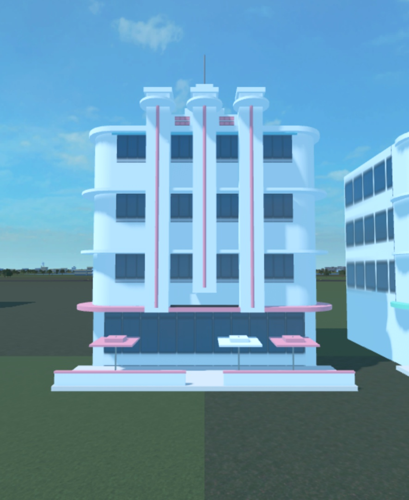
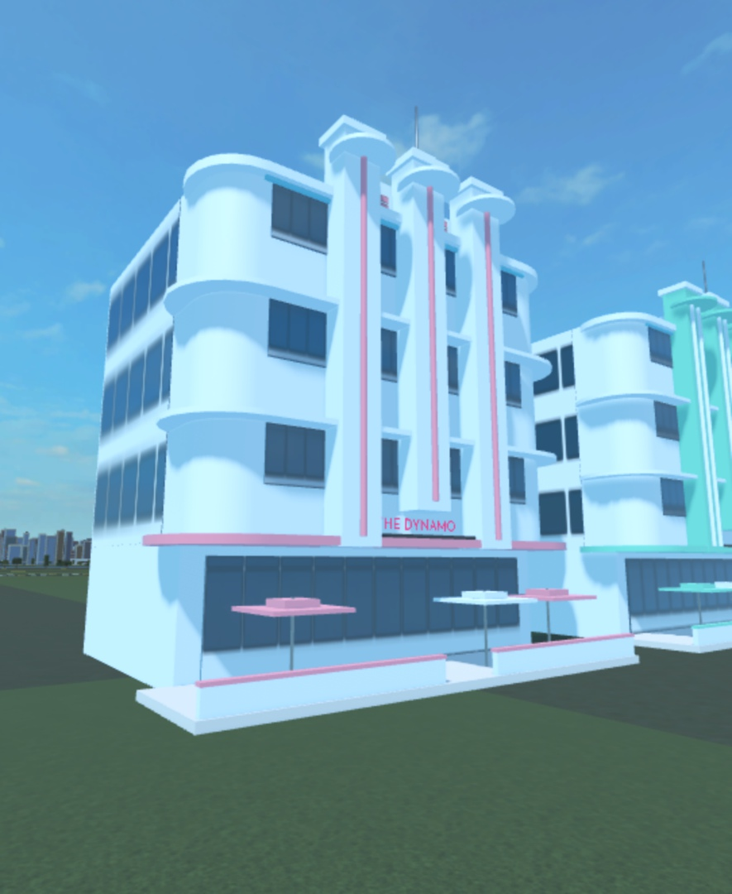
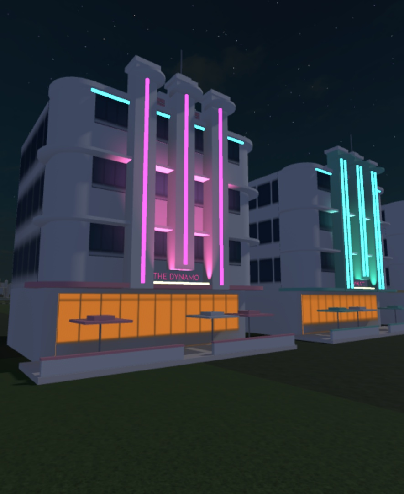
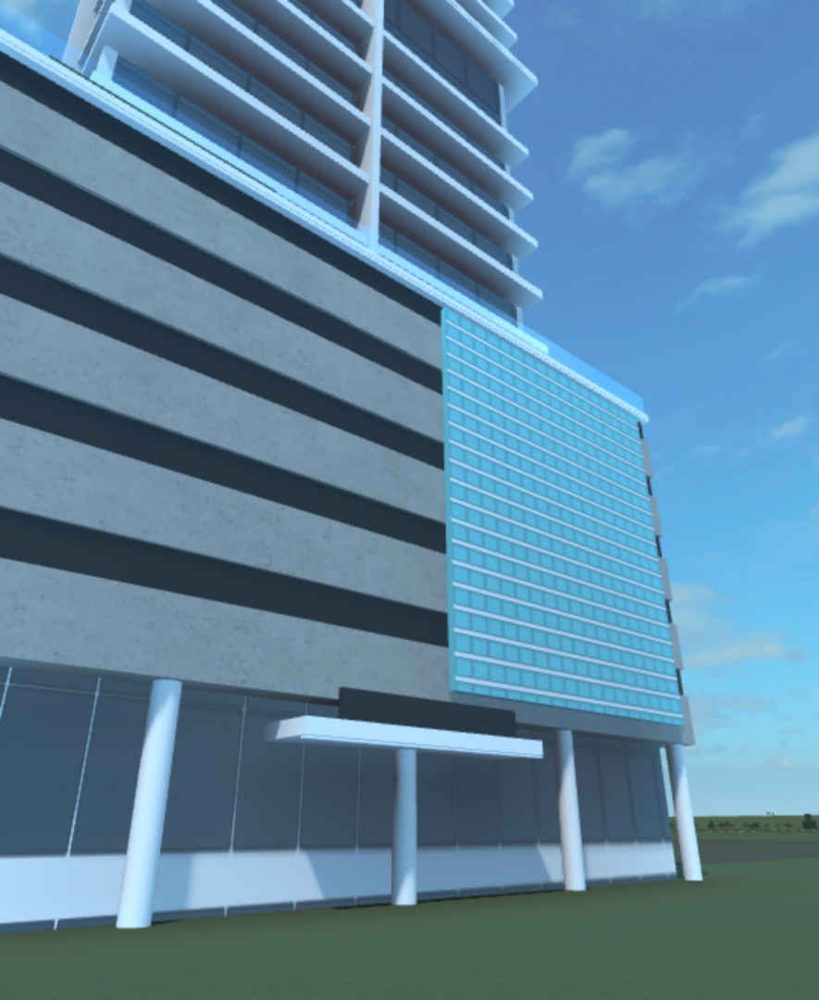
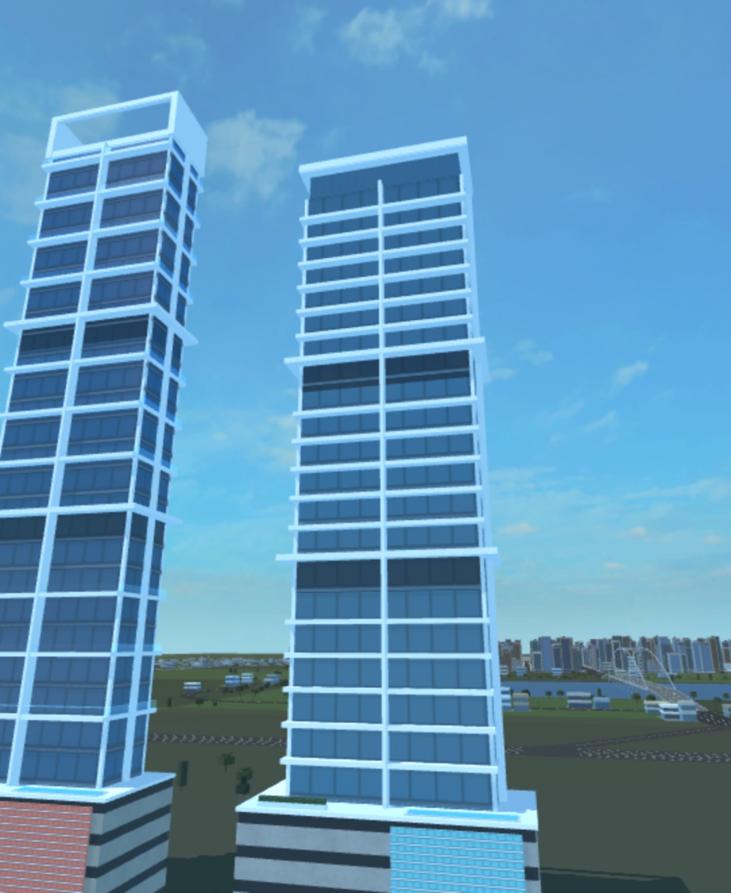
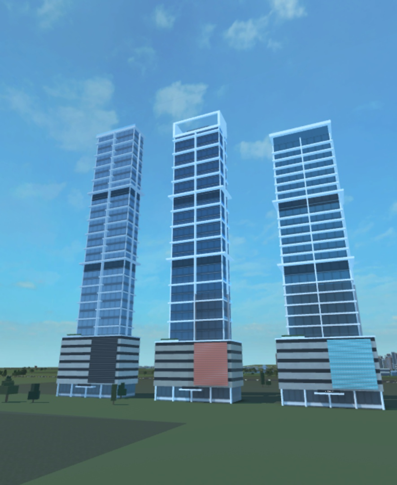
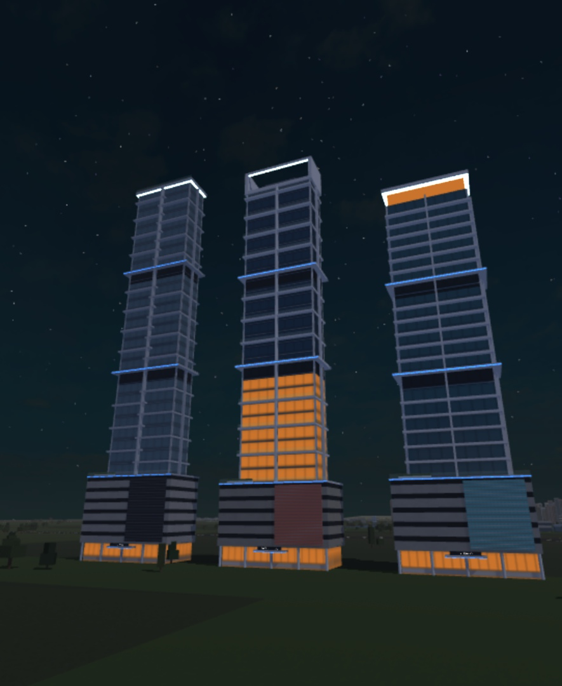
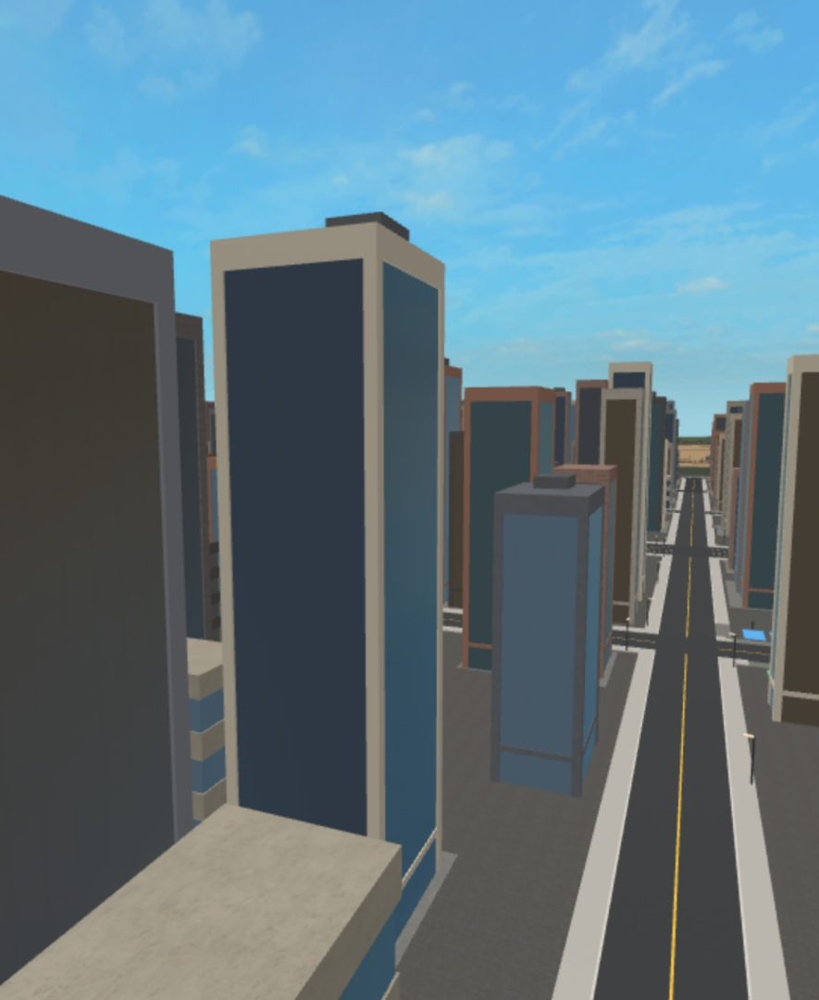

# Writing a city archetype

How to add one building type to the Miami city of Voltage County, so a dozen helpers can each write archetypes the
same way. Read `CITY_PLAN.md` (where things go), `ARCHETYPES.md` (what each building is, with its real inspiration),
`TECH.md` (what reads sharp in Roblox) and `SCENERY.md` (palettes, signs, fonts) first. This guide is the how.

Two archetypes are finished and set the bar. Copy their structure, not their shapes:

- `src/server/Dev/City/Archetypes/downtown/standard_glass_slab.luau` (T06, the standard glass condo tower)
- `src/server/Dev/City/Archetypes/beach/deco_stripe_hotel.luau` (B01, the three-stripe Art Deco hotel)

## 1. The pieces

| File | What it is |
|---|---|
| `src/shared/Config/City.luau` | Districts by zone, the archetype list with every placement number and part budget, the downtown height caps, the kit's shared numbers, window textures, palettes, sign names |
| `src/server/Dev/City/Types.luau` | `Plot`, `Site`, `Variant`, `Model`, `Archetype` |
| `src/server/Dev/City/Kit.luau` | The building kit: every primitive an archetype draws with. Pure: it returns `PartSpec`s |
| `src/server/Dev/City/Archetypes/<district>/<id>.luau` | One module per archetype: `{ id, build }` |
| `src/server/Dev/City/Archetypes/Index.luau` | The list of archetype modules |
| `src/server/Dev/City/CityBuilder.luau` | Placement (which archetype stands on which plots), building and checking a site |
| `src/server/Dev/City/Preview.luau` | Edit-mode previews: builds sample sites at z ≈ 4,000 to photograph |
| `src/server/Dev/MapTypes.luau` | The `PartSpec` type MapBuilder and the city share |
| `tests/City.spec.luau` | Checks every archetype on sample sites, every kit primitive and the placement rules |

How it plugs in: `Dev/MapBuilder` cuts plots along every town street exactly as before (same draws, same order, same
clear-checks), but instead of building each plot at once it hands the whole list to `CityBuilder.place`. The city
decides which plots become sites of which archetype; every other plot keeps the old facade (`addBuilding`), so the
city can grow one archetype at a time. A site that fails its checks falls back to the old facade with a note, and
`tests/MapBuilder.spec` fails on any note.

## 2. The interface

```lua
-- src/server/Dev/City/Archetypes/beach/my_archetype.luau
--!strict
local ReplicatedStorage = game:GetService("ReplicatedStorage")
local City = require(ReplicatedStorage.Shared.Config.City)
local Kit = require(script.Parent.Parent.Parent.Kit)
local Types = require(script.Parent.Parent.Parent.Types)

local function build(m: Types.Model)
	local site = m.site -- width, depth, height, variant, seed...
	-- draw with Kit.* into m
end

local archetype: Types.Archetype = { id = "my_archetype", build = build }
return archetype
```

Then:

1. Add it to `Archetypes/Index.luau`.
2. Add its entry to `Config/City.archetypes` (section 5). The id is its `ARCHETYPES.md` id (`neon_fin_hotel`,
   `sky_court_slab`...). Never a real building's name.
3. Run `tests/City.spec` and the preview.

### The site an archetype gets (`m.site`)

| Field | Meaning |
|---|---|
| `width`, `depth` | The footprint. x runs along the road from `-width/2` to `width/2`; z runs away from it from `-depth/2` (the front line) to `depth/2` (the back) |
| `height` | The main roof, drawn by placement inside the archetype's `heights` and the site's cap. Reach it (the spec checks the top is within 1 stud of it) |
| `maxHeight` | `height + crownMax`: nothing may rise above it (spires, flagpoles and signs included) |
| `variant` | `palette`, `crown`, `rhythm` (each 1..n, n from Config) and `mirror`. Every copy differs in at least one |
| `seed` | Its own random stream: `Kit.rng(m)` (add a salt for a second stream). Never `math.random` |
| `id` | `"B<n>"`; the kit prefixes every part name with it |
| `district`, `zone` | Where it stands |

Coordinates are the site's own, in studs: **x along the road, y up from the ground, z away from the road**. The front
faces the road: a part's `Front` face (-Z) is the face you see from the street. The kit turns local corners into the
site's frame and **mirrors x** when `variant.mirror` is set, so draw one handedness.

Rules the checks hold every site to (`CityBuilder.check`):

- every part's box inside the footprint (`|x| ≤ width/2`, `-depth/2 ≤ z ≤ depth/2`) and between `y = -1` and
  `maxHeight`
- at most `budget` parts
- every spec fit to build (`Kit.problem`): sizes, transparency, night-light kinds known, decor not raycastable
- every name starts with the site id, every part in the site's folder

Stay inside a little: neighbouring sites keep a 5-stud gap between them already, and anything that sticks out
past the sides (an eyebrow wrapping a rounded corner) needs the walls set in to make room (the hotel's `sideInset`).

## 3. The kit

Every helper takes the model `m` first, then a name (unique within the building: the kit refuses a repeat), and
returns the spec(s) it added. Corners are `Vector3` in site coordinates; the kit sorts min and max for you.

**Three kinds of part.** Pick by what a car and the sun should do with it:

| Kind | Helper | Collides | Shadow | For |
|---|---|---|---|---|
| box | `Kit.box` | yes | yes | walls, masses, podiums, anything a car could hit |
| trim | `Kit.trim` | no | yes (unless it is a sliver under 1 stud both ways) | eyebrows, fins, slab edges, cornices, canopies: their shadow lines are the look |
| detail | `Kit.detail` | no | no | mullions, rails, signs, neon, small trim |

**Primitives**

| Helper | Parts | Use |
|---|---|---|
| `look(color, material, reflectance?, transparency?)`, `glassLook(color, refl?)` | — | a material and colour |
| `box / trim / detail(m, name, min, max, look)` | 1 | boxes |
| `column(m, name, x, z, y0, y1, diameter, look, kind?)` | 1 | standing cylinders: drums, round columns, round towers |
| `disc(m, name, x, z, y, diameter, thick, look, kind?)` | 1 | flat round slabs: an eyebrow round a drum, a hood, a round balcony |
| `tube(m, name, a, b, diameter, look, kind?)` | 1 | a cylinder along one axis: rails, poles, porthole discs |
| `ball(m, name, centre, diameter, look, kind?)` | 1 | finials, domes sunk in a drum |
| `wedge(m, name, min, max, rise, look, kind?)` | 1 | slopes rising toward `"front" / "back" / "left" / "right"`: roofs, chamfers, raked tops |
| `glass(m, name, min, max, color, { image, faces, u, v, offsetV, lines, lit, reflectance })` | 1 | glass with a window-grid overlay (`City.textures`) on chosen faces; `lit` makes it glow at night |
| `punched(m, name, min, max, wall, glass, faces, u, v, lit?)` | 1 | a stucco wall with punched windows from one part (tiles count from the part's top, so make the top a floor line) |
| `roundedBox(m, name, min, max, radius, corners, look, kind?)` | 2..6 | a block with rounded vertical corners (`{ fl, fr, bl, br }`) |
| `band(m, name, bodyMin, bodyMax, radius, corners, y, thick, proud, look, "front" / "around")` | 1..6 | an eyebrow, cornice or balcony slab following a (rounded) body outline |
| `plates(m, name, coreMin, coreMax, y0, y1, every, thick, proudX, proudZ, look, rail?)` | 1..2 per floor | floor plates round a tower core, with an optional glass rail each |
| `setbacks(m, name, min, max, steps, look, kind?)` | 1 per step | stepped tops and setback towers; returns the top |
| `steppedCrown(m, name, x, z, y, tiers, look, ring?)` | 1..2 per tier | a stepped crown with a neon ring under each tier's top |
| `fins(m, name, side, plane, a0, a1, count, y0, y1, proud, thick, look)` | count | vertical fins on one face |
| `parapet(m, name, min, max, y, height, thick, look)` | 4 | four roof walls |
| `porthole(m, name, x, y, plane, diameter, glass, rim, kind?)` | 2 | a round window in a rim on the front face |
| `spire(m, name, x, z, y, height, diameter, look, segments?, beacon?)` | 1..4 | a tapering mast, a red beacon at the tip |
| `podium(m, name, min, max, levels, slot, proud, band, mass)` | 1 + levels | a parking podium: a dark mass under pale bands, one dark slot per level |
| `canopy(m, name, x0, x1, z0, z1, y, thick, look)` | 1 | an entrance canopy (may reach the front line) |
| `sign(m, name, min, max, face, text, board, textColor, font, kind?)` | 1 | a name board; text is a SurfaceGui. Names come from `City.signNames` |
| `neon(m, name, a, b, kind, dayColor, diameter?)` | 1 | a neon tube: a pastel moulding by day |
| `neonStrip(m, name, min, max, kind, dayColor)` | 1 | a flat lit strip: LED edges, crown rings |
| `wash(m, name, x0, x1, z, y, color)` | 1 | a facade wash: a fixture whose SurfaceLight lights the wall above it at night. One per hero facade |
| `pool(m, name, min, max, y)` | 2 | a rooftop or deck pool |
| `planter(m, name, min, max, look)` | 2 | a planter box with greenery |
| `umbrella(m, name, x, z, y, size, color, square?)` | 2..3 | café and market umbrellas |
| `roofBox(m, name, min, max, look?)` | 1 | stair and plant rooms |
| `lit(spec, kind)` | — | makes any spec a night light (`Config/Environment nightLights.kinds`) |
| `rng(m, salt?)`, `floors(height, floor)`, `face(m, face)` | — | helpers |

**Night-light kinds** (`Config/Environment nightLights.kinds`): `window` (glass that glows warm: day material Glass),
`sign` (cyan), `neonPink`, `neonViolet`, `neonAmber`, `neonBlue`, `crown` (a cool white for tower crowns), `ledBlue`
(balcony and podium edges), `uplight` (the wash fixture), `beacon`, `floodlight`, `streetlight`, `arch`. At most two
neon colours per building. No PointLights or SpotLights on buildings; a wash is the only light, one per hero facade.

**Textures** (`City.textures`, drawn for the city, in Davis's account): `windowFine` (curtain wall: thin mullions, a
spandrel per tile), `windowBold` (the same, bolder: lobbies, screens), `slabLine` (floor lines only), `punched` (a
wall with one window per tile). Tint them with `lines`; a tile is `u` studs across and `v` up. Textures add draw
calls: use them on the faces people see, not on every face of every part.

## 4. A worked example

A sketch of the shape of a small archetype (the real ones are longer; read the hotel next). It shows every step
an archetype takes: the recipe at the top, palettes, the variant, massing, depth, a signature, night, and the
café front.

```lua
--!strict
-- B02 neon_fin_hotel (docs/city/ARCHETYPES.md §6, B02): <one paragraph: what it is and what makes it itself>.
-- Placement, sizes, heights and its budget: Config/City archetypes.neon_fin_hotel.
-- Variants: palette (...), crown (...), rhythm (...), mirror.

local ReplicatedStorage = game:GetService("ReplicatedStorage")
local City = require(ReplicatedStorage.Shared.Config.City)
local Kit = require(script.Parent.Parent.Parent.Kit)
local Types = require(script.Parent.Parent.Parent.Types)

local P = City.palettes

-- The recipe, in studs. Every number the shape uses lives here, named.
local SHAPE = {
	ground = 14,
	floorMin = 10.5,
	terrace = 8,
	sideInset = 3.2, -- eyebrows wrap past the sides
	eyebrow = { thick = 0.6, proud = 2.6 },
	fin = { thick = 2, deep = 8, rise = 14 },
}

local PALETTES = {
	{ stripe = P.deco.aqua, neon = "neonBlue" },
	{ stripe = P.deco.mint, neon = "sign" },
}

local function build(m: Types.Model)
	local site = m.site
	local pal = PALETTES[math.clamp(site.variant.palette, 1, #PALETTES)]
	local hw, hd = site.width / 2, site.depth / 2
	local up = math.max(3, math.floor((site.height - SHAPE.ground) / SHAPE.floorMin))
	local f = (site.height - SHAPE.ground) / up
	local H = SHAPE.ground + up * f -- exactly site.height
	local x0, x1, zF, zB = -hw + SHAPE.sideInset, hw - SHAPE.sideInset, -hd + SHAPE.terrace, hd - 1
	local white = Kit.look(P.deco.white, Enum.Material.SmoothPlastic)

	-- Massing: one body, set 3+ behind the front line.
	Kit.box(m, "Body", Vector3.new(x0, -1, zF), Vector3.new(x1, H, zB), white)
	-- Depth: a ribbon window and an eyebrow per floor, wrapping the front corners.
	for k = 1, up do
		local top = SHAPE.ground + k * f - 1.4
		Kit.glass(m, `Window{k}`, Vector3.new(x0 + 2, top - 6, zF - 0.12), Vector3.new(x1 - 2, top, zF + 0.3), P.window.dark, {
			image = City.textures.windowFine, faces = { Enum.NormalId.Front }, u = 2.2, v = 6, lines = P.deco.white,
		})
		Kit.band(m, `Brow{k}`, Vector3.new(x0, 0, zF), Vector3.new(x1, 0, zB), 0, {}, top + 0.4, 0.6, 2.6, white, "front")
	end
	-- The signature: a tall fin over the entrance, its name lit at night.
	local fin = Kit.trim(m, "Fin", Vector3.new(-1, 10, zF - 8), Vector3.new(1, H + SHAPE.fin.rise, zF + 0.5), white)
	Kit.neon(m, "FinNeon", Vector3.new(0, 12, zF - 8.3), Vector3.new(0, H + 12, zF - 8.3), pal.neon, pal.stripe)
	-- ... marquee, terrace, umbrellas, a wash ...
end

local archetype: Types.Archetype = { id = "neon_fin_hotel", build = build }
return archetype
```

And its Config entry:

```lua
neon_fin_hotel = {
	district = "beach", weight = 1, maxCopies = 5, perBlock = 2, minSpacing = 220,
	minWidth = 40, maxWidth = 60, minDepth = 40, maxPlots = 2,
	heights = { min = 36, max = 48 }, crownMax = 18, budget = 45,
	palettes = 2, crowns = 1, rhythms = 1, ownModel = false,
},
```

## 5. Config/City: placement and limits

| Field | Meaning |
|---|---|
| `district` | `downtown`, `beach`, `suburbs`, `arts` or `quarry` (`City.districts` maps zones to these) |
| `weight` | Its chance among the district's candidates on a plot. The old facade weighs `districtLooks[d].legacyWeight` (lower it as the district's set fills up; 0 when complete) |
| `maxCopies`, `perBlock`, `minSpacing` | At most this many in the map, in one city block, and this far apart (centre to centre) |
| `minWidth`, `maxWidth`, `minDepth`, `maxPlots` | The site sizes it fits. A plot is 26..52 studs along the road and 53 deep; a site keeps a 5-stud gap to its neighbours, so one plot gives a 21..47 site. An archetype wider than one plot merges up to `maxPlots` neighbouring plots of one run |
| `heights` | Its main roof's range. Downtown, a site's block cap (`City.heightCaps`, CITY_PLAN §2) lowers the top of the range, and an archetype whose `min` is over the cap doesn't stand there. A site near a gameplay spot is capped at `nearSpotCap` (160) |
| `crownMax` | How far crowns, spires, signs and flagpoles may rise over the roof |
| `budget` | Parts per site, at most. `tests/City.spec` prints the range it saw |
| `palettes`, `crowns`, `rhythms` | How many of each variant the module knows. Placement draws each copy's variant and gives every copy a look (archetype, palette, crown, rhythm) no other copy has while one is left |
| `ownModel` | Its own Atomic model (`Buildings/Tower<n>`): yes for towers (anything 160+ gets one anyway) |

Placement, in short (CityBuilder header has the detail): plots are grouped in runs (one frontage, no gap); on each
plot the plot's own random stream draws among the archetypes that fit (width, depth, cap, copies, spacing, block)
and the old facade; one archetype never stands beside itself on a run. Deterministic: the same layout gives the same
city. Not yet done (the planner's step): claims into the empty block cores, the one-off landmarks of CITY_PLAN §5,
neighbours across the street and round corners, the no-twin-heights rule.

## 6. The quality bar

Davis, 2026-10-25: "models have to be sharp", "each building has to have its own unique inspiration", "big,
unique buildings". The two references, in the game's runtime light (shadows and sky light on; Davis will set
Future lighting, which only sharpens them):

| | |
|---|---|
|  |  |
|  |  |
|  |  |
|  |  |

The last picture is downtown as it was. The first-round versions of the two references
(`round1-*.jpg`) show what a first pass misses: a north-facing photo in shade, flat eyebrows, toy umbrellas,
office-grid glass. Each took three rounds.

What the references do that every archetype must:

1. **One idea you can read at 70 mph.** The hotel's three stripes rising past the roof; the tower's white balcony
   lines broken by dark sky decks under a white crown. Name it in the module's header.
2. **Two depths on every facade, and shadow lines.** Glass sits in, something stands 0.5..5 proud: eyebrows, plates,
   fins, cornices, pilasters. A flat box with a texture is never enough.
3. **A plinth, an entrance and a top.** Every building meets the ground (a podium, a terrace, a base band), shows
   where you go in (a canopy, a porch, a sign) and finishes its top (a crown, a cornice, a parapet, a roof room).
4. **No coplanar faces.** Anything laid on a face stands at least 0.05 proud; where two masses share a top, offset
   one by a few hundredths (the kit's rounded boxes already do).
5. **Real proportions.** 12-stud floors downtown, 10.5..11 on the beach, a 14..16-stud ground floor; mullions never
   thinner than 0.3; balcony plates 1..2 thick and 3..5 proud. A car is 18 long and a player 5 tall.
6. **Colour with a rule.** Towers stay cool (blue and teal glass, white frames); Deco is white with one pastel accent
   per building; palettes from `City.palettes` (tested under the game's light, pushed past the paint chip). Never
   white Neon; at most two neon colours a building.
7. **Night.** Something on the building lights at dusk: lit glass, a crown, LED edges, neon, a wash.
8. **Variants that change the silhouette, not just the colour.** The tower's three crowns (overhang and spire,
   open frame, sky pool) and three balcony rhythms; the hotel's white or pastel pilasters and one or two flutes.
9. **The budget.** About 40..65 parts for a building like these; up to 120 for a one-off landmark. Merge nothing
   with CSG yet (untested at map scale).
10. **Invented names only.** No real building, hotel, business or brand name in code, comments, instance names or
    signs. The inspiration's name lives in `ARCHETYPES.md` and nowhere else.

## 7. Look at your work

Studio's Edit mode starts with shadows and sky light off, which hides every edge the city is built to show.
`Dev/City/Preview` turns on the game's runtime light, builds sample sites on the empty grass at z ≈ 4,000 facing
south (into the afternoon sun), switches their night lights, and puts everything back.

1. Sync the repo into Studio: run `python tools/studio_sync.py --timeout 120` in the background, then run
   `tools/StudioSync.luau` through `execute_luau` (Edit datamodel).
2. Require fresh copies (execute_luau caches modules between runs), build, and put the originals back:

```lua
local RS, SSS = game:GetService("ReplicatedStorage"), game:GetService("ServerScriptService")
local oShared, oServer = RS.Shared, SSS.Server
local cShared, cServer = oShared:Clone(), oServer:Clone()
oShared.Parent, oServer.Parent = nil, nil
cShared.Parent, cServer.Parent = RS, SSS
local ok, result = pcall(function()
	local Preview = require(cServer.Dev.City.Preview)
	Preview.lighting(true)                                  -- the runtime light, 2 pm
	local out = {}
	for _, model in Preview.row("my_archetype", { count = 3, at = Vector3.new(0, 0, 4000) }) do
		table.insert(out, `{model.Name}={model:GetAttribute("Parts")}`)
	end
	return table.concat(out, ", ")
end)
cShared:Destroy(); cServer:Destroy()
oShared.Parent, oServer.Parent = RS, SSS
return tostring(ok) .. " " .. tostring(result)
```

3. Photograph it with `screen_capture` from the south (the fronts face +Z): for a low building about 90 studs
   out at eye height, e.g. camera `(-46, 12, 4072)` looking at `(6, 28, 4000)`; for a tower a mid view
   `(x + 60, 120, 4250)` and a street view at y 6. `Preview.night(true)` for the night look (and `false` to go
   back). Options: `width`, `depth`, `height`, `variant`, `seed`, `facing = "north"`.
4. Compare it honestly with a photo of the real inspiration (Wikimedia Commons has most of them). Fix what
   doesn't read, rebuild, photograph again: at least two rounds.
5. `Preview.clear()` removes the models and puts Lighting and the camera back. Put the best pictures in
   `docs/images/city/<id>-<view>.jpg`.

## 8. The checklist

Before an archetype is done:

- [ ] Module in `Archetypes/<district>/<id>.luau`, `--!strict`, a header naming its `ARCHETYPES.md` entry, its
      one idea, and its variants; the recipe's numbers in a named `SHAPE` table
- [ ] Listed in `Archetypes/Index.luau`; its entry in `Config/City.archetypes` with honest sizes, heights and budget
- [ ] Reaches `site.height`; stays inside the footprint and under `maxHeight` at every size in its range
- [ ] Every variant knob changes something you can see from the street
- [ ] Plinth, entrance, top; two facade depths; no coplanar faces; trim and detail used for decor
- [ ] Lit at night with known kinds; at most one wash; no PointLights or SpotLights
- [ ] Photographed day and night, from two angles, compared with the real building, at least two rounds
- [ ] `tests/City.spec` passes (it builds every archetype at its min, mid and max widths, both depths, both heights,
      three seeds and rotating variants, and checks it twice for determinism)
- [ ] `tests/MapBuilder.spec` passes: the county plans with no notes, inside `Environment.budget`
      (raise `buildingParts` with the reason if the city needs it), and every placed site re-checks clean
- [ ] `powershell -ExecutionPolicy Bypass -File scripts/check.ps1` ends with `CHECK PASSED`
- [ ] No real names anywhere in `src/` or `tests/`

Run the specs in Studio on a fresh clone (same clone-swap as above, then
`require(cShared.Testing.Harness).runFolder(<a clone of ServerStorage.Tests>)`). The county plan takes a while: run
it in `task.spawn`, store the result in an attribute on ServerStorage, read it back in a second call, and remove the
attribute afterwards.

## 9. Known limits and what comes next

- **Placement is per plot and per run.** The planner step (CITY_PLAN §4) still has to add: tower claims into the
  empty block cores (L1), the one-off landmarks at their anchors (§5), neighbours across the street and round
  corners, the no-twin-heights rule, density overrides (L2) and the Skyline model.
- **Night lights share the building's model.** For SLIM (TECH §6) they move to sibling light models; `Kit.lit` is the
  one place that tags them, so the split is one change in the kit and CityBuilder.
- **Lit glass glows strongly orange** on large areas (`window`'s night colour). TECH §4 suggests a dimmer, less
  saturated colour; that is the lighting owner's call.
- **Budgets.** With the two references placed, the county plans about 15,800 parts (`mapParts` 16,000) and 5,800
  building parts (`buildingParts` raised to 6,400). The full city needs CITY_PLAN §9's budgets (L4, after a perf
  drive and Davis's phone).
- **Sign text** shows in Edit-mode screenshots for these parts but check it in a playtest too.
